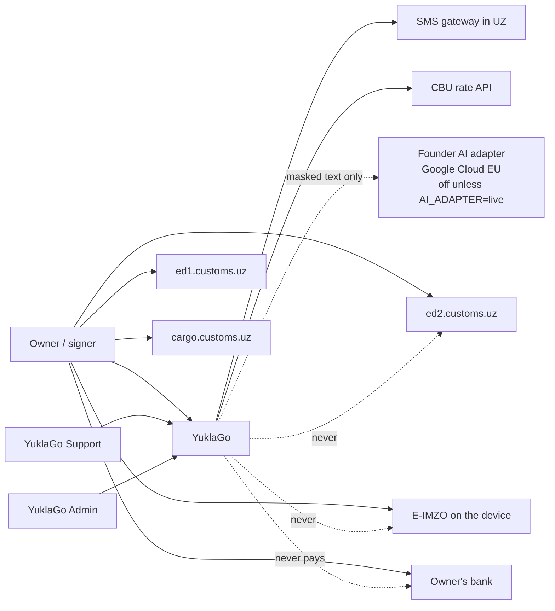
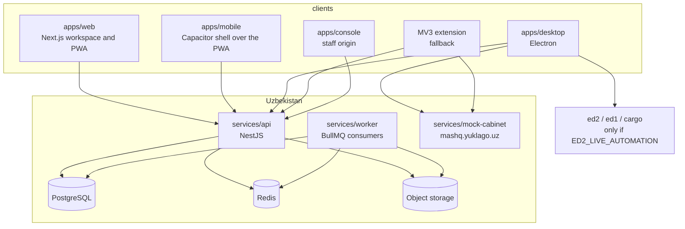
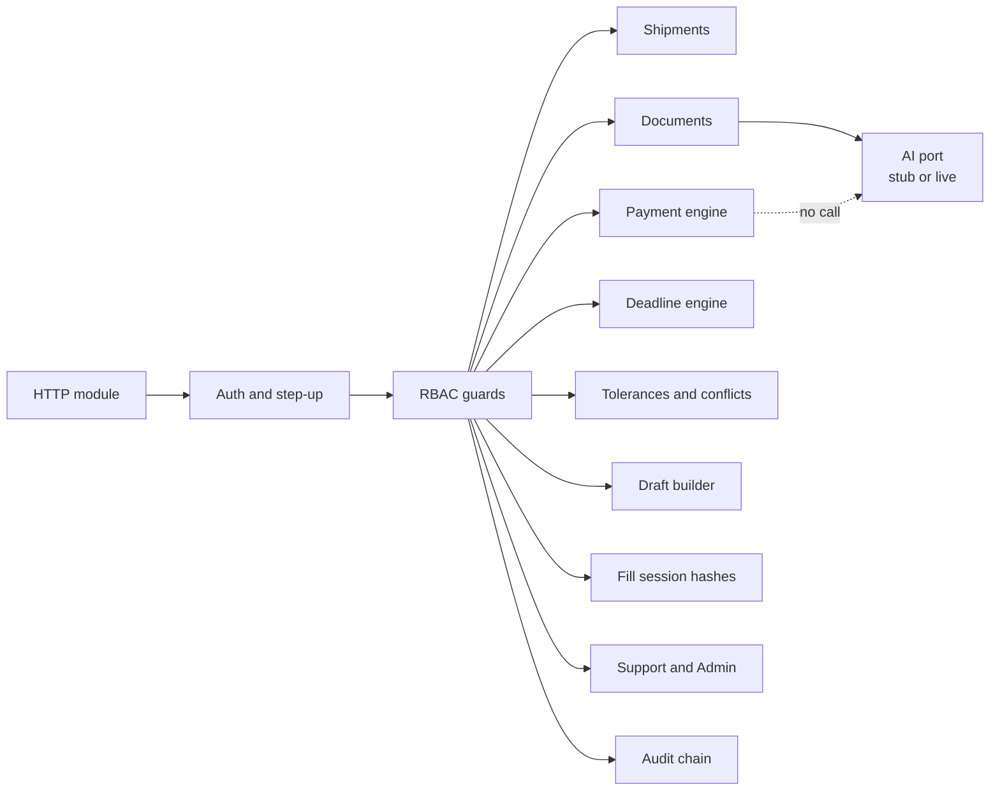

# Architecture

YuklaGo is a modular monolith plus a desktop fill client. One API serves the web workspace, the mobile shell, the Electron app, and the staff console. Cabinet fill runs on the user's computer. The server never holds an ed2 session.

## Context

The owner logs in to ed2 with their own key. YuklaGo opens the page and types fields. It does not call E-IMZO itself. The local E-IMZO service (`wss://127.0.0.1:64443`, observed on ed2's own script) is contacted by the cabinet page, not by YuklaGo code.

ed2 sends `X-Frame-Options: SAMEORIGIN` (observed 18.11.2026). The web app must not iframe it. The Electron window is a top-level browser view, so that header does not apply. That observation is not a promise that the header stays.

There is no public filing API. Do not claim one.

## Containers

| Container | Responsibility |
|---|---|
| `apps/web` | Landing, set-up, shipments, settings, PWA. No cabinet fill. |
| `apps/mobile` | Installable shell around the same web UI. Camera and push only. No signing. |
| `apps/desktop` | Embedded cabinet, fill engine, local full session log, hard stop before ERI. |
| MV3 extension | Same fill engine in the user's browser when the app cannot be installed, or when E-IMZO fails in Electron. |
| `apps/console` | Support and Admin on a separate origin. Separate cookies from the client app. |
| `services/api` | Auth, RBAC, shipments, calc, drafts, grants, config, audit. |
| `services/worker` | Clocks reminders, grant expiry, retention, AI jobs via the port. |
| `services/mock-cabinet` | Practice declaration form. Not ed2. |
| PostgreSQL, Redis, object storage | All in Uzbekistan for staging and production. |

## API components

The payment engine, deadline engine, tolerance checks, and go/no-go lookup are pure functions in `packages/calc` and `packages/checks`. They take versioned rule data from `data/` and admin config. They do not call the AI port.

## Trust boundaries

- **Device.** ERI key, PIN, cabinet cookies, and the full fill-value log stay here. The embedded profile is memory-only and wiped when the session ends or after 15 minutes idle.
- **Uzbekistan server.** Accounts, documents, confirmed field values, calculation traces, audit hashes, masked support views. Signer comparison uses HMAC with a key that stays here. Raw PINFL is not written to disk or logs.
- **Staff console.** A different site. Support sees a grant-scoped masked projection. Admin sees config tables only. The API enforces this even if the UI is skipped.
- **Founder AI adapter.** Off by default. When on, it receives masked text only, from the worker in the live adapter. Certificate HMACs never leave Uzbekistan. Google Cloud DPA review is [PENDING: Huquq] (DEC-15, PC-10).

## What is intentionally absent

- Server-side Playwright against ed2. The token is on the user's PC.
- Scraping ed1. `CABINET_STATUS_READ` defaults off. The user types the registration number and the authority end date.
- A client role other than Owner. Several people at one company means several accounts, identical rights (DEC-29).
- Payment initiation. The UI shows the amount and the user's own bank steps.
