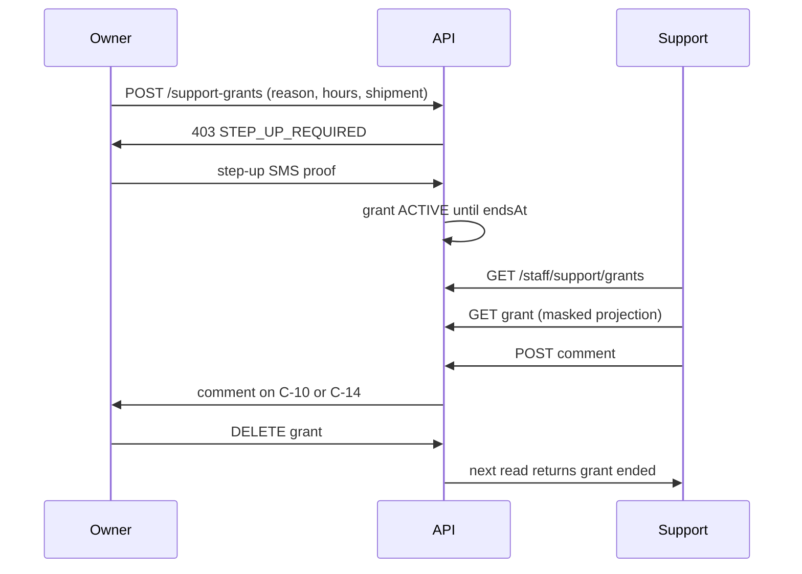

# Auth, roles, step-up, support access

Three roles (DEC-29, ADR 0003). The matrix is normative. The API must match it even if a screen hides a button.

## Permission matrix

| Action | Owner | Support | Admin |
|---|---|---|---|
| View documents and draft | Yes | Active grant only, masked | No |
| View unmasked name, PINFL, passport, phone | Yes | No | No |
| Edit or prepare | Yes | No. Comments only | No |
| Sign or send in ed2 | Yes, locally, own E-IMZO | No | No |
| Pay | Yes, own bank | No | No |
| Export audit pack, PDF, CSV, own log | Yes. Full export needs step-up | No | No |
| Tariffs, calendar, tolerances, flags | No | No | Yes, logged |
| Give or withdraw AI consent | Yes | No | No |
| Grant or revoke Support access | Yes | No | No |
| Read audit log | Own, and the company's rows by person | Own session only | Config log only |

Separation of duties from spec §6A:

1. Staff never sign, send, or pay, never join a client's ed1 list, and never log in to a client's cabinet.
2. The ERI stays on the owner's device.
3. Support and Admin are different people. Both use TOTP. A password-only staff login is rejected.
4. Nobody grants support access to themselves. The owner grants it. Default 24 hours. The owner can revoke. The worker closes it at `endsAt`.
5. A 🔒 flag needs two approvers, one of them the DPO. The requester cannot approve their own request.
6. Step-up SMS for exactly five triggers. No SMS for payment or signing. The bank and the ERI already authenticate those.
7. A new device notifies the owner's other sessions with "Sessiyani tugatish".
8. A stolen owner account has full client rights. Triggers 6 and 7 are the mitigation. Do not add a second client role to "fix" that.

## Sessions

- Owner: phone OTP, 6 digits, hash stored, 5 minute TTL, 3 attempts, then locked 10 minutes. Matches S-01.
- A known device can complete sign-in with the OTP that is the sign-in code. A new device uses that same code plus the reason line "Yangi qurilmadan kirish." There is not a second SMS (screen hand-off, decision 2).
- Desktop (D-01) always treats a first login on that installation as a new device. Do not offer "Davom etish" from the web session.
- Staff: email, password, then TOTP. Wrong role shows "Bu hisob Yordam xizmati uchun emas." or the admin equivalent. No client-style SMS.
- Refresh tokens are stored as hashes. Idle desktop cabinet profile: 15 minutes, then wipe cookies, storage, cache, and downloaded files in that profile. Show "Sessiya maʼlumotlari bu kompyuterdan oʻchirildi".
- Session fixation: rotate the session id after OTP and after TOTP.

## The five step-up triggers

| Trigger enum | Screen | Reason line (UZ) |
|---|---|---|
| `NEW_DEVICE` | C-02, D-01 | Yangi qurilmadan kirish. |
| `SIGNER_CHANGE` | S-03 after "Ha" | Imzolovchi oʻzgarishini tasdiqlash. |
| `SUPPORT_ACCESS` | S-02 "Ruxsat berish" | Yordam xizmatiga 24 soatlik ruxsat. |
| `FULL_DATA_EXPORT` | S-05 "Barcha maʼlumotlar" | Barcha maʼlumotlarni yuklab olish. |
| `ACCOUNT_DELETION` | S-06 after the typed word | Hisobni butunlay oʻchirish. |

Audit-pack PDF for one shipment and the security-log CSV do not require step-up. Only "Barcha maʼlumotlar" does (S-05).

Cancel returns without a change. Three wrong codes lock the challenge for 10 minutes.

## Support access flow

Masked projection rules:

- Person name becomes initials plus bullets (`D••• K.`).
- Phone becomes `+998 •• ••• •• ••` style, keeping no more than the pattern already used on C-20 for the owner's own masked phone. Support sees less: no subscriber digits beyond a fixed mask.
- PINFL shows at most the last 4 digits.
- Document previews are rendered server-side with bars over personal regions. The original object is not sent to the console.
- Watermark text: "YORDAM XIZMATI · faqat koʻrish".
- There is no client search. The list is the grants assigned to this staff member, or all active grants if you later add a queue. v1 lists active grants and nothing else. There is no "open any client" query.

Support comments are labelled "YuklaGo izohi, rasmiy kod emas". They do not write `DraftField`.

If Support would pass a document to a third party, the product does not offer that action. AC-43.11 forbids uploading client documents to tools outside YuklaGo's processing. A future export to a third party would have to notify the data subject within 3 days (ZRU-547 art. 23 part 2, as read by Huquq). Do not build that action in v1.

## Signer check

`POST /v1/setup/signer` stores the user's confirmation and the authority end date.

`POST /v1/signer/certificate` accepts only PINFL, STIR, serial, and validity, over TLS. The server returns `match` or `mismatch`. On mismatch the fill routes stay locked only after the user answers "Yoʻq".

Until an E-IMZO API key exists for the YuklaGo domain (PC-16, [UNVERIFIED] how to obtain one), the desktop app cannot list certificates itself. Reusing ed2's localhost keys is a bypass and is forbidden (R58). Fallback: the user confirms once at set-up and again when they tell the app they have a new key (AC-1.9).

`CERT_PUBLIC_FIELDS_AUTODETECT` defaults true and is 🔒. It still needs the named responsible person's sign-off before launch.

## Client UI language

Never show the words "Support" or "Admin" on a client screen. The staff product name on those screens is "Yordam xizmati".
