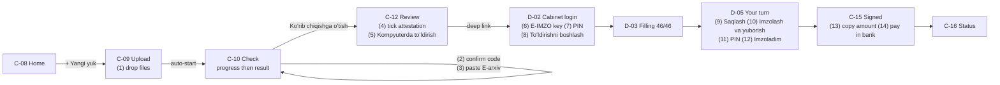
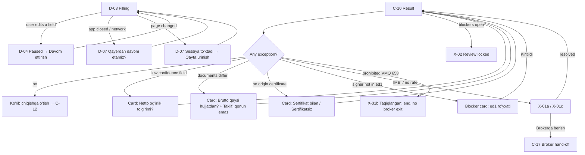
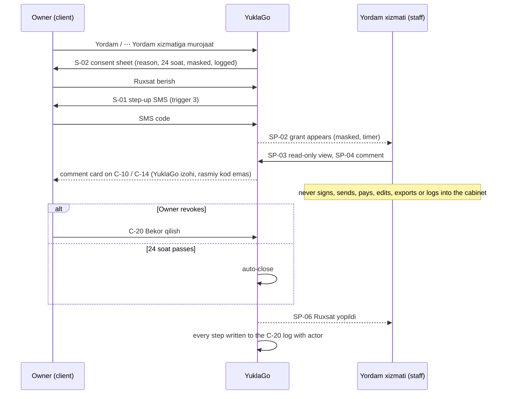
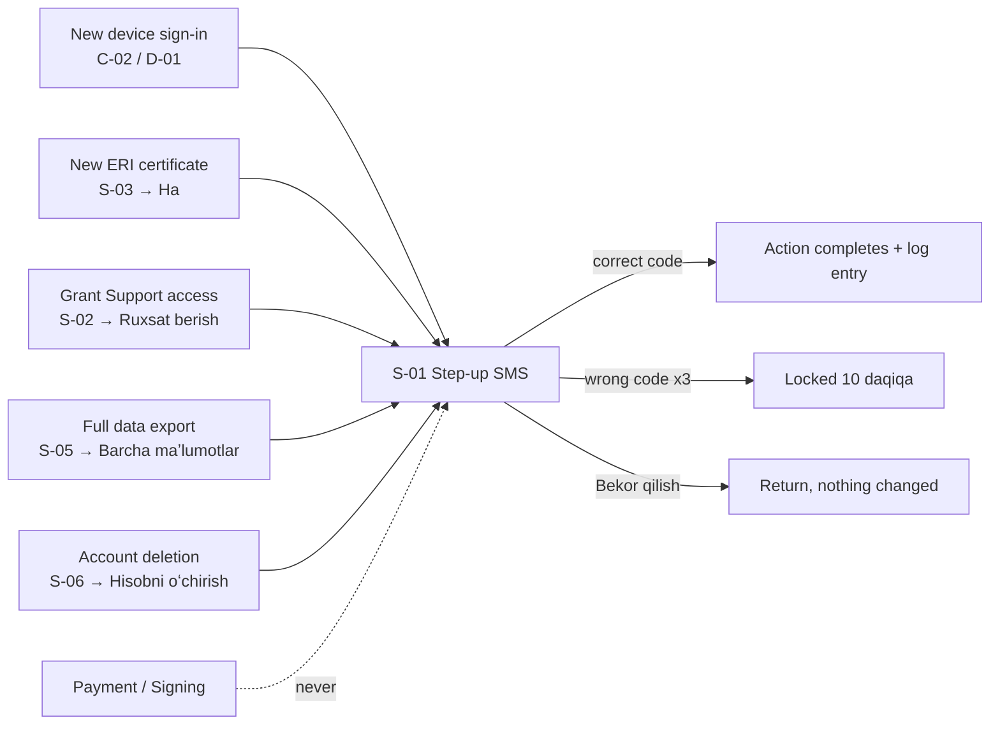

**Visual reference (view only):** https://www.figma.com/design/MJCyZ6SiNj6HdesKbwxDcM/YuklaGo-%E2%80%94-Product-UI-v1.0

**For:** the engineer building the product · **From:** the YuklaGo product team · **Version:** hand-off 1.0, 19.11.2026

This file is the screen contract: screen IDs, exact UI copy, states and behaviour. It is not a generation brief.

**What you get:**
- **Baseline:** `ref/source-v0.5.pdf` (29 boards; the "v0.5 pN" references below point to its pages).
- **Gap list:** `ref/clarifications-v0.5.pdf` (6 blockers and 11 polish items, all folded into this spec).
- **Brand:** the brand files in `/workspace/yuklago-brand/final/`.
- **Earlier rounds** (background only): `design-v0.4/simplify-brief-v0.4.pdf`, `design-v0.3/clarifications-v0.3.pdf` and `design-v0.2/`. Where they conflict with this document, **this document wins**.

**How to read it:**
- Every screen has an ID (`C-` client web, `D-` desktop app with the embedded cabinet, `M-` mobile, `S-` shared sheets, `I-` info sheets, `X-` system states, `SP-` support console, `AD-` admin console).
- Frames in the Figma file use these IDs (§8).
- UI copy is given exactly, in Uzbek Latin. RU is given wherever the product ships RU, which means every client-facing screen.
- Text in *italics* is a note, not UI copy.
- `[NEW]` marks something v0.5 does not have. `[FIX]` marks a v0.5 board to reuse with a stated change.

# 1. The product and the rules

## 1.1 The product in one paragraph

YuklaGo lets a small Uzbek importer or exporter file their own customs declaration without a broker. The user drops the shipment documents (invoice, CMR, contract and so on). YuklaGo reads them, proposes the TIF TN code, checks permits, works out every payment and the filing deadline, and builds the 46-grafa draft, all on one live screen. It then asks only what the law or low confidence requires, one question at a time. After one review, the YuklaGo desktop app opens the user's **own** customs cabinet (ed2.customs.uz) in an embedded window and fills it field by field in front of them. It stops at the E-IMZO electronic signature (ERI): the user presses "Saqlash", signs with their own key and sends it themselves. YuklaGo never logs in, never signs, never sends and never pays. The positioning line is **"Brokersiz, oʻzingiz topshirasiz — tez va tushunarli."**

## 1.2 Design principles (measurable; the review checks these)

| # | Rule | Target | How it is counted |
|---|---|---|---|
| R1 | Progressive disclosure | One question or one result per screen. Detail sits one tap away: (i) sheet → audit pack → "Grafalar koʻrinishi" expert view → "Batafsil". | Nothing from the (i) layer is printed on the screen itself. |
| R2 | One primary action | **Exactly 1** filled (indigo) button per screen; ≤ 2 visible secondary actions (outline or text); everything else in the ⋯ overflow. | Error states and sheets count too. A segmented control is not a button. |
| R3 | Short copy | **≤ 60 words** of body copy per screen; headline ≤ 6 words; no sentence over 14 words. | Not counted: data, labels, table cells, numbers, codes, chips, button labels, menus, and the must-show lines in §5.1. |
| R4 | Short path | **≤ 6 screens** from the first upload to "Imzoladim" on the clean path. This spec uses **5**: C-09 → C-10 → C-12 → D-03 → D-05. | An exception is a **card on the same screen**, never a new page. First-time set-up is outside the count. |
| R5 | Few inputs | **≤ 7 YuklaGo inputs** and **≤ 15 actions in total** (including ERI login, Saqlash, Sign and payment) on the clean path of a returning user. This spec uses **4 inputs and 14 actions** (§6.1). | Not counted: step-up SMS sheets, (i) taps, menus, edits. |
| R6 | Laws only as chips | No article or decree number inside a sentence. A source sits in a chip on the number it supports (e.g. `PQ-181 · 16.02.2026`), and the article text is one tap away. | Any "…BK 261-moddasiga koʻra…" in a sentence fails. |
| R7 | Status = icon + word + action | Never colour alone and never a bare "Diqqat". Every status names the next step ("Netto ogʻirlikni tasdiqlang"). | — |
| R8 | One progress element | A 5-stage stepper: **Hujjatlar → Tekshiruv → Koʻrib chiqish → Toʻldirish → Holat**. | The same 5 names everywhere, including overview boards. |
| R9 | Simpler never means less correct | Every number keeps its source chip and its "≈ Taxmin" / "Namuna" label. | — |
| R10 | RU fits | RU strings fit the same caps with +25 % length. | — |

# 2. Brand and design system

## 2.1 Brand "Varaq" (do not change)

- **Logo:** the mark is a folded declaration sheet with a "Y" inside. The wordmark is one word in one colour, "YuklaGo". It always has clear space of at least ¼ of the mark height.
  - **Don't:** stretch, rotate, add a shadow, split "Yukla"/"Go" into two colours, put it in a circle or seal, pair it with flag colours, or place it on saffron.
- **Colours:**
  - **Indigo `#2E2BA0`** (`brand.primary`): primary buttons, links, focus, selected states. Hover `#24218A`, pressed `#1C1A70`. Tint `#ECEBFA` for selected rows. Dark `#14143F`.
  - **Saffron `#F5B43C`** (`brand.accent`) appears in **exactly two places**: the logo fold, and the "Endi sizning navbatingiz" (your turn) panel (top rule and step numbers) on D-05. It is never text, an icon on white, a link, a button fill or a warning colour, and never carries white text.
  - **Text:** ink `#14152B`, secondary `#525570`, muted `#5E6178` (muted only on surface, canvas, sunken or tint; never on ink).
  - **Backgrounds:** canvas `#F5F5FA`, surface `#FFFFFF`, sunken `#EEEFF5`.
  - **Borders:** line `#E1E2EC` and strong `#C5CCD8` are for decorative dividers only. Input `#84899A` goes on any control whose outline is its only edge.
  - **Status (fg / bg / border):**
    - go "Mos keladi / Tayyor": `#12795A / #E7F5EF / #B7DFCC`
    - caution "Diqqat": `#A35C00 / #FFF4E0 / #F0D3A0`
    - stop "Toʻsiq": `#C0362C / #FDECEA / #F3C1BC`, which is also the destructive colour
    - info "Maʼlumot": `#2457A6 / #EAF1FB / #C3D5EF`
  - **Practice (MASHQ):** banner `#E8EBF1` with border `#C5CCD8`; pill `#3A4256` with white text.
  - **Buttons** come in three styles only: indigo filled, white outline, or red (destructive). There are no black, pink, petrol or saffron buttons. Selected segments use tint `#ECEBFA` with indigo text, not ink fill (polish P6).
- **Type:**
  - **Onest** 400/500/600/700 for all UI.
  - **JetBrains Mono** only for TIF TN codes, grafa IDs, E-arxiv/registration numbers, URLs and code placeholders (polish P7: the p18 placeholder must be JetBrains Mono, not a fallback font).
  - **Scale:** display 40/48 (landing only), h1 28/36, h2 22/30, h3 18/26, bodyLg 18/28, body 16/24, bodySm 14/20, label 14/20 (600 on buttons), caption 13/18, overline 12/16 uppercase +0.06em, amountXl 32/40 tnum, amount 16/24 tnum, code 14/20 mono.
  - **Money** always uses tabular numerals, never wraps (`nowrap`), groups thousands with a thin space ("16 222 400") and shows whole soʻm. Contract-currency amounts keep 2 decimals ("27 700,00 CNY").
  - **TIF TN display format** is `8539 52 000 9` (mono) everywhere. Raw `8539520009` appears **only** where it is the value typed into the cabinet (cabinet field, fill rail "Kabinetga yoziladi", expert view column "Kabinetga yoziladi").
- **The oʻ/gʻ rule:** always U+02BB (ʻ) in oʻ, gʻ, Oʻ, Gʻ; the tutuq belgisi is U+02BC (ʼ), as in "maʼlumot". Never use `'`, `‘` or `’`. Inputs auto-replace these after o/g. Use non-breaking hyphens in "E-IMZO", "E-arxiv", "e-imzo.soliq.uz" and "E-kontrakt" (polish P11).
- **Radius:** chips 6, buttons and inputs 10, cards 14, sheets and modals 20, pills 9999.
- **Spacing:** 4-pt base: 4, 8, 12, 16, 20, 24, 32, 40, 48, 64, 80. Page padding 24–32; card padding 16–20.
- **Shadows:** xs–lg, ink-tinted 6–12 %.
- **Focus ring:** 2 px `#2E2BA0`, 2 px offset.

## 2.2 Files (use these; do not redraw the logo)

| What | Path |
|---|---|
| Brand guidelines | `/workspace/yuklago-brand/final/brand-guidelines.md` |
| Tokens (source of truth) | `/workspace/yuklago-brand/final/tokens/brand-tokens.json` |
| Tokens as CSS / Tailwind | `/workspace/yuklago-brand/final/tokens/tokens.css`, `tailwind.v4.css`, `tailwind.config.snippet.js` |
| Contrast report | `/workspace/yuklago-brand/final/tokens/contrast-report.md` |
| UI tokens (components) | `/workspace/hackathon/team-review/ui-tokens.json` |
| Logo (vector) | `/workspace/yuklago-brand/final/logo/svg/`: `lockup-horizontal-small-color.svg` (header), `lockup-horizontal-color.svg`, `lockup-horizontal-on-dark.svg` (dark panels), `lockup-stacked-*.svg`, `mark-color.svg`, `mark-small-color.svg` (16–32 px), `mark-on-dark.svg`, `app-icon.svg`, `favicon.svg` |
| Logo (raster) | `/workspace/yuklago-brand/final/logo/png/`, `logo/favicon/`, `logo/app-icon/` |
| Specimens | `/workspace/yuklago-brand/final/brand-sheet.png`, `type-specimen.png`, `mock-mode-specimen.png` (each with `@2x`) |

Logo sizes: horizontal lockup ≥ 32 px tall in documents. Header: `lockup-horizontal-small-color` at 20–32 px tall. Desktop title bar: `mark-small-color` at **≥ 16 px** (never smaller). On ink or indigo-950 use the `on-dark` files.

## 2.3 Layout grid

- **Web desktop:** 1440 frame, 12-column grid, 1200 max content width, 24 gutters, 32 page padding. Focused single-task screens (C-09, C-17, sheets) use an 8-column, 640–720 content column.
- **Desktop app (D-):** 1440 × 900 window. Left: the embedded cabinet pane (flexible, ≥ 960). Right: the YuklaGo rail at a fixed **360** wide. Title bar 32.
- **Mobile (M-):** 390 × 844, 16 side padding, bottom-pinned primary button.
- **Consoles (SP-, AD-):** 1440, a left nav of 240, a dense table layout. The brand is muted (§2.6).

## 2.4 Components and their states

Build each one as a Figma component with the variants listed. All interactive components have **default / hover / pressed / focus / disabled** states; inputs also have **filled / error / read-only** states.

| Component | Variants / notes |
|---|---|
| **Button** | `primary` (indigo fill), `secondary` (white, 1 px `#84899A`, indigo text), `text` (indigo link style), `destructive` (red fill for the final confirm; red text in menus), `icon` (⋯). Sizes L 48 / M 40 / S 32. Optional leading icon. A `loading` state shows a spinner and keeps the width. |
| **Input** | text, phone (+998 mask), STIR (9 digits, masked "309 ••• •••" after confirm), date (dd.mm.yyyy), number (kg, comma decimal), multiline paste (E-arxiv). Label above, helper below, error text in stop red with an icon. |
| **OTP** | 6 boxes, auto-advance, paste support, "Qayta yuborish 0:59" countdown, error shake (no colour-only error). |
| **Radio card / choice card** | title + optional caption (e.g. "Sotish uchun" / "43-grafa: 0"); selected = tint bg + indigo 1.5 px border. |
| **Checkbox** | Unticked by default, always. Label right. Used for consent and attestation. |
| **Chip — source** | caption, sunken or tint bg, radius 6: `PQ-181 · 16.02.2026`, `SK 258`, `VMQ 55 · PF-115`, `BK 261`. Tap opens the (i) sheet. |
| **Chip — label** | `≈ Taxmin` (caution bg), `Namuna` (sunken), `Taklif, qonun emas` (info bg), `YuklaGo izohi, rasmiy kod emas` (info bg), `sertifikat bilan` (sunken). |
| **Status badge** | icon + word: `Mos keladi` (go, check), `Tasdiqlang` (caution, triangle), `Toʻsiq` (stop, x-circle), `Maʼlumot` (info, i), `Kutilmoqda` (muted, clock), `Ishlayapti` (indigo, spinner), `Siz tasdiqladingiz` (go, check: user's own action only). |
| **Stepper** | 5 stages (R8); stage states done (go check) / current (indigo filled number) / upcoming (outline number). One line, under the shipment header. |
| **Header (app shell)** | §2.5. |
| **Shipment header** | overline `YG-0412 · IM 40 · import`; h2 title "LED lampochkalar"; right: **deadline chip** + ⋯ overflow; below: stepper. |
| **Deadline chip** | caution-tinted pill, clock icon: line 1 **"Topshiring 27.11 · 8 kun"**, line 2 caption **"chegara 28.11 · post taqvimi tasdiqlanmagan"**, (i) icon → I-02. States: normal (caution), ≤ 2 days (stop), passed (stop, "Muddat oʻtdi"). Hidden until the deadline is known. |
| **Card** | radius 14, surface, 16–20 padding. Types: result card (overline + amountXl + chips + (i) link), list card ("Sizdan kerak" rows: icon + one line + badge + chevron), question card (overline reason + h3 question + control + 1 primary + ≤ 1 secondary), blocker card (stop icon + word, h3, ≤ 20 words, action). |
| **Sheet / modal** | radius 20, max width 560, a scrim of ink at 40 %. Header: title + close ×. Footer: one primary, optional text link. |
| **Toast** | ink bg, white text, 4 s; used only for "Nusxalandi" (copied). |
| **Table** | bodySm, 48 rows, right-aligned tabular amounts, mono codes. |
| **Skeleton** | sunken blocks, pulse 1.2 s. |
| **Banner — MASHQ** | §2.7. |
| **Overflow menu (⋯)** | 8 radius, rows 40, destructive row last in red text. |
| **Language dropdown** | §2.5. |
| **Avatar** | tint circle with indigo initials "DK"; one style everywhere. |
| **Doc row** | file icon + doc type + mono filename + status badge (`Yuklandi` / `Oʻqilmoqda` / `Tanildi` / `Ochilmadi`). |
| **Source crop** | the invoice image crop with the read value outlined in indigo 1.5 px; caption "invoice_GM-2611.pdf · 1-bet". |

## 2.5 Header and language dropdown (one component everywhere)

**Signed-in web header (height 64, surface, bottom line `#E1E2EC`):**

- **Left:** the logo (`lockup-horizontal-small-color`, 24 px tall), which links to Bosh sahifa.
- **Nav:** **Bosh sahifa · Yuklar · Mahsulotlar** (RU: **Главная · Грузы · Товары**). The current item is indigo with a 2 px underline.
- **Focused sub-flows** (inside a shipment: C-09…C-17) replace the nav with a back link **"← Yuklar"** (RU "← Грузы") and keep everything on the right.
- **Right, in this order:**
  - **"Yordam"** text link (RU "Помощь") `[NEW]`. It opens S-02.
  - **Language dropdown.**
  - **User menu:** avatar "DK" + "Namuna Savdo MChJ" + chevron. The open menu shows the company name, "Dilshod K. · STIR 309 ••• •••", then **Sozlamalar · ERI va kabinet · Chiqish** (RU: Настройки · ЭЦП и кабинет · Выйти; "Chiqish" in red text).
- **Signed-out header** (C-01): logo, nav "Qanday ishlaydi · Batafsil", then on the right "Yordam", the language dropdown, and **"Kirish" as a secondary (outline) button** (polish P2).

**Language dropdown (fixes the v0.2/v0.3 issue; v0.5 p3, p24, p29 are correct; keep them):**

- **Closed trigger:** globe icon + the current language in its own script + chevron: **"Oʻzbekcha ⌄"** or **"Русский ⌄"**. Outline style (the secondary button look), height 40. Never show "UZ · RU" side by side as equals, never use a segmented control and never use flags.
- **Open:** a menu with exactly 2 rows, "Oʻzbekcha" and "Русский", each in its own script. The current row has a tint bg and an indigo ✓. The menu opens **downward, right-aligned under the trigger**, and must never cover a primary button (move the button or open to the left).
- **Mobile:** globe + "UZ" / "RU" + chevron.
- **Keyboard:** focus ring, arrow keys, `lang="uz-Latn"` / `lang="ru"` on the rows.
- **The choice** is saved to the account and synced with Settings → Til (C-19). It changes the UI only, never the values written to the cabinet.
- **Draw:** closed UZ, open UZ ✓, closed RU.
- **Not shown** in the desktop fill window (D-) or the consoles. The language follows the account there.

## 2.6 Console styling (SP-, AD-)

These consoles are internal staff tools on separate staff accounts. Same tokens and Onest, but:
- an ink `#14152B` top bar, 48 high, with `lockup-horizontal-small-on-dark` and a role tag pill: **"YORDAM XIZMATI"** (Support) or **"ADMIN"**;
- no saffron anywhere;
- Uzbek only (internal).

The client UI **never** shows the words "Support" or "Admin". It says "Yordam xizmati" and "YuklaGo".

## 2.7 MASHQ (practice) banner

The banner appears on every mock-cabinet surface and **only there** (D- screens in practice mode, and the practice row in C-12). It never appears on web planning screens and never in real mode.

1. **Banner** pinned at the very top of the desktop window, under the title bar, not dismissible. Height 36, bg `#E8EBF1`, bottom border `#C5CCD8`.
   - **UZ:** pill **"MASHQ"** + "**Mashq rejimi** — bu haqiqiy bojxona kabineti emas. Hech narsa bojxonaga yuborilmaydi." Link right: "Haqiqiy rejim haqida".
   - **RU:** pill **"УЧЕБНЫЙ РЕЖИМ"** + "Это не настоящий кабинет таможни. Ничего не отправляется." Link: "О реальном режиме".
2. **Pill** `#3A4256`, white, 12/16, 600, uppercase. It repeats in the mock cabinet's URL bar: "MASHQ · https://mashq.yuklago.uz/kabinet/deklaratsiya/yangi" + right caption "Mashq kabineti · YuklaGo emas".
3. A 3 px `#3A4256` top rule on the mock cabinet frame, plus a **horizontal** watermark "MASHQ · УЧЕБНЫЙ РЕЖИМ" in ink at 4 % opacity (never diagonal).
4. Never use pink, hazard yellow, hatching or status colours for practice.

**Real mode (D- variants):** no banner, no pill, no watermark. The URL bar shows "https://ed2.customs.uz/…" + caption "Rasmiy sayt · YuklaGo emas".

# 3. The three roles

There are exactly 3 roles (DEC-29). There is no role picker, no invites with permissions, no "viewer" or "accountant" account.

| | **Owner / User** (client) | **YuklaGo Support** ("Yordam xizmati") | **YuklaGo Admin** |
|---|---|---|---|
| Who | The person who signs. That is the director or a YaTT, or a staff customs specialist entered in the company's ed1 declaring-persons list. Several people in one company each have their **own** account (own phone, own ERI, own ed1 entry), all with identical rights. An accountant gets the audit-pack export, not a login. | YuklaGo staff, on a separate staff account with mandatory 2FA. | YuklaGo staff, on a separate staff account with mandatory 2FA (never the same person as Support). |
| Sees | Everything for their company: shipments, documents, draft, payments, their own security log. | **Only** shipments of a client who granted access, **only** while the grant is active (default **24 soat**, closes itself), with **PII masked** (no full name, PINFL, passport or phone). Only their own session log. | **Only** configuration: tariff editions, the ops calendar, tolerances, feature flags, the config log. **No client documents, drafts or personal data**, and no route to them. |
| Does | Uploads, answers, confirms the code (and is liable for it), reviews, fills via the app, **logs in, signs and sends in their own cabinet with their own ERI**, pays from their own bank, grants or revokes Support access, exports. | Reads, and leaves comments or suggestions on a field. | Edits configuration (each change logged with a source and date). Flags that expose client data (🔒 DPO) need a second approval by the DPO. |
| Never | Shares the login or uses another person's key. | Signs, sends, pays, edits or exports client data, joins the client's ed1 / TIF participants list, logs into the client's cabinet, uploads client documents to outside AI tools, or grants access to themselves. | Opens client data, or turns on a 🔒 DPO flag alone. |
| Screens | C-, D-, M-, S-, I-, X- | SP-01…SP-06 | AD-01…AD-07 |

**Step-up SMS (Owner)** is required for **exactly five triggers**: (1) sign-in from a new device, (2) a signer change (new ERI certificate), (3) granting Support access, (4) a full data export, (5) account deletion. There is **no** SMS for payment or signing: the bank and the ERI already confirm those. Step-up sheets are excluded from the R5 counts.

# 4. Screen inventory

## 4.0 Overview

| Area | IDs | Count |
|---|---|---|
| Client web: entry and set-up | C-01 … C-07 | 7 |
| Client web: shipments | C-08 … C-18 | 11 |
| Client web: account | C-19, C-20 | 2 |
| Desktop app (embedded cabinet) | D-01 … D-07 | 7 |
| Mobile (PWA) | M-01 … M-04 | 4 |
| Shared sheets and cards | S-01 … S-06 | 6 |
| Info (i) sheets and detail layers | I-01 … I-06 | 6 |
| System states | X-01 … X-08 | 8 |
| Support console (internal) | SP-01 … SP-06 | 6 |
| Admin console (internal) | AD-01 … AD-07 | 7 |
| **Total** | | **64** |

| ID | Screen | Stepper stage | v0.5 source | Status |
|---|---|---|---|---|
| C-01 | Landing | — | p5 (top) | FIX |
| C-02 | Sign-in (phone → SMS) | — | p5 (bottom) | FIX |
| C-03 | Set-up 1/4: STIR | — | p6 card 1 | reuse |
| C-04 | Set-up 2/4: ERI key | — | p6 cards 2–3 | reuse |
| C-05 | Set-up 3/4: **"Siz imzolaysiz"** signer check | — | replaces p6 cards 3/5 + 4/5 | **NEW** |
| C-06 | Set-up 4/4: desktop app | — | p6 card 5 | reuse |
| C-07 | Set-up done | — | p6 "Tayyor" | reuse |
| C-08 | Home (Bosh sahifa) | — | p24 | FIX |
| C-09 | New shipment: consent + upload | Hujjatlar | p7 | **FIX (consent first)** |
| C-10 | Check: live progress → result → questions | Tekshiruv | p8 + p9 + p10 | FIX |
| C-11 | Multi-line invoice result (variant of C-10) | Tekshiruv | p21 | reuse |
| C-12 | Review the draft | Koʻrib chiqish | p11 | FIX |
| C-13 | Hand-off to the desktop app | Koʻrib chiqish → Toʻldirish | p12 (top) | FIX |
| C-14 | Shipment overview (resume point) | any | p25 | FIX |
| C-15 | Session end: signed + payment | Holat | p18 (left) | FIX |
| C-16 | Status tracking + message explainer | Holat | p26 | reuse |
| C-17 | Broker hand-off | any | p23 | reuse |
| C-18 | Mahsulotlar (product library) | — | nav only | **NEW** |
| C-19 | Settings (Sozlamalar) | — | p27 | FIX |
| C-20 | Xavfsizlik: devices, Support access, security log | — | — | **NEW** |
| D-01 | App sign-in | — | p12 (bottom left) | FIX |
| D-02 | Cabinet login (wait for user) | Toʻldirish | p13 | reuse |
| D-03 | Filling | Toʻldirish | p14, p17 (top) | reuse |
| D-04 | Paused / you changed a field | Toʻldirish | p15 | reuse |
| D-05 | Your turn: Save → ERI → Sign | Toʻldirish | p16, p17 (bottom) | **FIX (signing line)** |
| D-06 | E-IMZO not found | Toʻldirish | p12 (bottom right) | reuse |
| D-07 | Session recovery / session stopped | Toʻldirish | p18 (right) | **NEW + FIX** |
| M-01 | Mobile home | — | p28 (1) | FIX |
| M-02 | Mobile: one question | Tekshiruv | p28 (2) | reuse |
| M-03 | Mobile: result | Tekshiruv | p28 (3) | reuse |
| M-04 | Mobile: continue on computer | Toʻldirish | p28 (4) | reuse |
| S-01 | Step-up SMS sheet (5 triggers) | — | — | **NEW** |
| S-02 | Yordam + Support-access consent sheet | — | — | **NEW** |
| S-03 | New signer key card | — | — | **NEW** |
| S-04 | New-device notice | — | — | **NEW** |
| S-05 | Data export sheet | — | — | **NEW** |
| S-06 | Account deletion sheet | — | — | **NEW** |
| I-01 | Toʻlovlar tarkibi (payments breakdown) | — | p22 | FIX |
| I-02 | Nega ikki sana? (deadlines) | — | p22 | reuse |
| I-03 | Batafsil (what YuklaGo does / doesn't) | — | p22 | reuse |
| I-04 | Grafalar koʻrinishi (expert view) | — | p22 | reuse |
| I-05 | Audit paketi | — | p22 | reuse |
| I-06 | Generic (i) source sheet | — | — | **NEW** |
| X-01 | Blocker cards: IMEI, prohibited, no rate | — | p19 | FIX |
| X-02 | Review locked (open blockers) | — | p19 | FIX |
| X-03 | Empty states | — | p19 | FIX |
| X-04 | Upload error | — | p19 | reuse |
| X-05 | Offline | — | p19 | reuse |
| X-06 | Loading skeletons | — | p19 | reuse |
| X-07 | Regime / export / pre-arrival question cards | Tekshiruv | p20 | reuse |
| X-08 | Server error / session expired | — | — | **NEW** |
| SP-01 … SP-06 | Support console | — | — | **NEW** |
| AD-01 … AD-07 | Admin console | — | — | **NEW** |

**The five clean-path screens (R4):** C-09 → C-10 → C-12 → D-03 (D-02 is the same window) → D-05 "Imzoladim". Then C-15 is the end screen.

## 4.1 Global rules for every client screen

- **Shell:**
  - **C-01…C-08 and C-18…C-20:** the signed-in header (§2.5).
  - **Shipment screens C-09…C-17:** the header in "← Yuklar" mode + the shipment header + the stepper.
- **"Yordam":** always in the header. Also in the ⋯ overflow of every blocker or error card, as "Yordam xizmatiga murojaat", which opens S-02.
- **Broker:** only in the shipment ⋯ menu ("Brokerga berish"), never as a box or button on a screen (except X-01 "no rate", where it is the secondary text link).
- **Deadline:** shown **once**, as the deadline chip in the shipment header. Never repeat it in the page body (home rows may show "27.11 · 8 kun").
- **Shipment ⋯ menu:** Grafalar koʻrinishi · Audit paketi (PDF) · Brokerga berish · Yordam xizmatiga murojaat · Yukni oʻchirish (red text, last). RU: Вид по графам · Аудит-пакет (PDF) · Передать брокеру · Обратиться в поддержку · Удалить груз.
- **Copy:** each screen states its word count in the frame description (R3), so the review can check it.

## 4.2 Client web: entry and set-up

### C-01 Landing · v0.5 p5 (top) · FIX

- **Purpose:** explain the product in one look, prove it with a sample calculation, and start.
- **Entry:** yuklago.uz.
- **Exit:** "Boshlash" or "Kirish" goes to C-02. "Batafsil" goes to I-03.
- **Layout:**
  1. Signed-out header (§2.5).
  2. Hero, two columns: left has the headline, subline, CTA row and trust line; right has the sample calculation card.
  3. A row of 3 icon-step cards.
  4. Footer line.
- **Components:** display headline; bodyLg; primary L "Boshlash"; text link "Batafsil"; sample result card with source chips; 3 step cards (icon tile in a tint square, number, h3, caption).

| Element | UZ | RU |
|---|---|---|
| Headline (display) | Brokersiz, oʻzingiz topshirasiz — tez va tushunarli | Без брокера — подаёте сами, быстро и понятно |
| Subline | Hujjatlarni yuklang. YuklaGo hisoblaydi, tekshiradi va kabinetingizni toʻldiradi. Siz oʻzingiz imzolab, oʻzingiz yuborasiz. | Загрузите документы. YuklaGo посчитает, проверит и заполнит ваш кабинет. Подписываете и отправляете вы сами. |
| Primary | Boshlash | Начать |
| Secondary link | Batafsil | Подробнее |
| Trust line (shield icon) | ERI kalit va parolingizni hech qachon soʻramaymiz. | Мы никогда не просим ключ ЭЦП и пароль. |
| Card overline | NAMUNA HISOB | ПРИМЕР РАСЧЁТА |
| Card title | LED lampochkalar · 2 000 dona · Xitoy | LED-лампы · 2 000 шт. · Китай |
| Rows | Bojxona qiymati `≈ Taxmin` ≈ 54 800 000 · Boj · 15 % `PQ-181 · 16.02.2026` 8 220 000 · QQS · 12 % `SK 258` 7 562 400 · Bojxona yigʻimi · 1 BHM `VMQ 55 · PF-115` 440 000 | Таможенная стоимость `≈ Оценка` · Пошлина · 15 % · НДС · 12 % · Таможенный сбор · 1 БРВ |
| Total | Toʻlovlar `Namuna` **≈ 16 222 400 soʻm** | Платежи `Образец` **≈ 16 222 400 сум** |
| Step 1 | Yuklang — Invoys, yuk xati va shartnoma. | Загрузите — инвойс, накладная и договор. |
| Step 2 | Tekshiramiz — Kod, ruxsatlar, toʻlovlar va muddat. | Проверяем — код, разрешения, платежи и срок. |
| Step 3 | Kabinetingizni toʻldiramiz — siz imzolaysiz. Oʻz ERI kalitingiz bilan. | Заполняем ваш кабинет — подписываете вы. Своим ключом ЭЦП. |
| Footer | YuklaGo — mustaqil xizmat, davlat organi emas. | YuklaGo — независимый сервис, не госорган. |

- **States:** default; language RU; narrow (stacked).
- **Acceptance:**
  - [ ] Exactly 1 filled button ("Boshlash"); the header "Kirish" is an outline button (P2).
  - [ ] The subline says "Siz oʻzingiz imzolab, oʻzingiz yuborasiz", not "Siz faqat imzolaysiz" (P2).
  - [ ] Every amount has a chip; the total carries "Namuna".
  - [ ] "Yordam" is in the header.
  - [ ] No banned phrase (§5.2).

### C-02 Sign-in · v0.5 p5 (bottom) · FIX

- **Purpose:** phone + SMS sign-in (this is the YuklaGo account only, never the ERI).
- **Entry:** C-01 "Boshlash" or "Kirish".
- **Exit:** a new account goes to C-03; a returning user goes to C-08. On a **new device** of an existing account, the SMS code here doubles as the step-up (S-01 trigger 1, reason line shown), and the other devices get S-04.
- **Layout:** centred sheet (560) over the landing, in two steps.
- **Components:** phone input with a +998 mask; OTP 6; primary; resend countdown.

| Element | UZ | RU |
|---|---|---|
| Step 1 title | Telefon raqamingiz | Ваш номер телефона |
| Field label | Telefon | Телефон |
| Primary | Kod olish | Получить код |
| Step 2 title | SMS kodni kiriting | Введите код из SMS |
| Helper | +998 90 ••• •• 67 raqamiga yubordik. | Отправили на +998 90 ••• •• 67. |
| Resend | Qayta yuborish · 0:59 | Отправить снова · 0:59 |
| Primary | Kirish | Войти |
| New-device reason line | Yangi qurilmadan kirish. Boshqa qurilmalaringizga xabar boradi. | Вход с нового устройства. Мы сообщим на другие ваши устройства. |
| Error | Kod notoʻgʻri. Qayta kiriting. | Неверный код. Введите снова. |
| Locked | Juda koʻp urinish. 10 daqiqadan keyin qayta urining. | Слишком много попыток. Попробуйте через 10 минут. |

- **States:** empty, typing, sending (loading button), code entered, wrong code, too many attempts, new device.
- **Acceptance:**
  - [ ] "Kirish" is disabled until 6 digits are entered.
  - [ ] No password field anywhere.
  - [ ] There is a new-device variant.

### C-03 Set-up 1/4: STIR · v0.5 p6 card 1 · reuse

- **Purpose:** identify the company.
- **Entry:** first sign-in.
- **Exit:** C-04.
- **Layout:** one centred card (560) with the progress "1 / 4" (4 thin segments).
- **Components:** STIR input (9 digits); company match card (go); primary; text link.

| Element | UZ | RU |
|---|---|---|
| Page title | Bir martalik sozlash | Однократная настройка |
| Page subline | Toʻrt savol. Har yukda qayta soʻralmaydi. | Четыре вопроса. Для каждого груза не повторяются. |
| Card title | Kompaniyangiz STIR raqami | ИНН вашей компании |
| Match card | ✓ Namuna Savdo MChJ · Toshkent sh., Chilonzor t. | ✓ Namuna Savdo MChJ · г. Ташкент, Чиланзарский р-н |
| Primary | Ha, bu bizning kompaniya | Да, это наша компания |
| Text link | Boshqa STIR | Другой ИНН |
| Not found | STIR boʻyicha kompaniya topilmadi. Raqamni tekshiring. | Компания по ИНН не найдена. Проверьте номер. |

- **States:** empty; looking up (skeleton in the match card); found; not found; network error (X-05).
- **Acceptance:**
  - [ ] Progress reads "1 / 4" (the old "Besh savol · 1/5" becomes 4, because the signer and ed1 cards merged into C-05).

### C-04 Set-up 2/4: ERI key · v0.5 p6 cards 2–3 · reuse

- **Exit:** "Ha, bor" + Davom etish goes to C-05. "Yoʻq" + Davom etish shows the no-key state.

| Element | UZ | RU |
|---|---|---|
| Title | E-IMZO kalitingiz bormi? | У вас есть ключ E‑IMZO? |
| Options | Ha, bor · Yoʻq | Да, есть · Нет |
| Trust line | Kalitni YuklaGo hech qachon koʻrmaydi. | YuklaGo никогда не видит ваш ключ. |
| Primary | Davom etish | Продолжить |
| No-key state: badge | ⓘ Kalit yoʻq | ⓘ Ключа нет |
| No-key title | Avval ERI kaliti kerak | Сначала нужен ключ ЭЦП |
| No-key body | Davlat xizmatlari markazida yoki e‑imzo.soliq.uz orqali oling. Hozircha hisob-kitob qilishingiz mumkin. | Получите в ЦГУ или на e‑imzo.soliq.uz. Пока можно сделать расчёт. |
| No-key primary / link | Hisoblab koʻrish · Kalit oldim | Сделать расчёт · Ключ получен |

- **Acceptance:**
  - [ ] "e‑imzo.soliq.uz" never breaks across lines (P11).
  - [ ] Without a key, the user can still reach C-09…C-10 (calculation), and C-12's "Kompyuterda toʻldirish" is locked (X-02).

### C-05 Set-up 3/4: "Siz imzolaysiz" · NEW (replaces the v0.5 p6 role picker and the ed1 card) · BLOCKER B1

- **Purpose:** confirm that the person using this account is the person who signs, that they are in the ed1 declaring-persons list, and until when. **There is no role picker:** never show "Kim imzolaydi?", "Shtatdagi mutaxassis" or "Broker mutaxassisi".
- **Entry:** C-04 "Ha, bor".
- **Exit:** C-06.
- **Layout:** one card (560), progress 3 / 4. Top to bottom:
  1. Title.
  2. A two-row check list (ERI ✓; ed1 question).
  3. Conditional date field.
  4. The fixed lines block (caption, ink, shield icon).
  5. The primary button.
- **Components:** a check row (go badge "Bor" for ERI, from C-04); a radio pair; a date input + "Muddatsiz" checkbox; an expandable text link "Rahbar emasman"; a lines block.

| Element | UZ | RU |
|---|---|---|
| Title | Siz imzolaysiz | Подписываете вы |
| Row 1 | ERI kalitingiz · ✓ Bor | Ваш ключ ЭЦП · ✓ Есть |
| Row 2 question | Siz ed1 roʻyxatidamisiz? | Вы в списке ed1? |
| Options | Ha, kiritilganman · Hali yoʻq | Да, я в списке · Пока нет |
| Date field (if "Ha") | Vakolat muddati tugaydi · dd.mm.yyyy · ☐ Muddatsiz | Полномочия действуют до · ☐ Бессрочно |
| "Hali yoʻq" helper (caution card) | Topshirishdan oldin kerak: my.gov.uz orqali roʻyxatga kiriting. Qanday? | Нужно до подачи: внесите себя в список через my.gov.uz. Как? |
| Text link (reveals one line) | Rahbar emasman | Я не руководитель |
| Revealed line | Direktor ed1 → TIF ishtirokchilari roʻyxati orqali sizni qoʻshishi kerak. | Директор должен добавить вас через ed1 → список участников ВЭД. |
| **Fixed line 1 (must show)** | Imzolovchi — deklaratsiyalovchi shaxslar roʻyxatiga kiritilgan shaxs. | Подписант — лицо из списка декларирующих лиц. |
| **Fixed line 2 (must show)** | Faqat oʻz ERI kalitingiz bilan imzolang. Boshqa odamning kalitini ishlatmang. | Подписывайте только своим ключом ЭЦП. Не используйте чужой ключ. |
| **Fixed line 3 (must show)** | Brokersiz, oʻzingiz topshirasiz. | Без брокера — подаёте сами. |
| Primary | Davom etish | Продолжить |
| Success toast-free confirm (row turns go) | ✓ Siz imzolaysiz | ✓ Подписываете вы |

- **States:**
  - **default:** nothing selected, primary disabled;
  - **"Ha":** the date field is required unless "Muddatsiz" is ticked;
  - **"Hali yoʻq":** caution card; the primary is enabled; set-up continues, and filing stays locked later (X-02 row "ed1 roʻyxati");
  - **link expanded;**
  - **date in the past:** error "Bu sana oʻtib ketgan." / "Эта дата уже прошла.".
- **Acceptance:**
  - [ ] No choice of *who* signs anywhere.
  - [ ] All 3 fixed lines are visible without a tap.
  - [ ] The authority end date is captured.
  - [ ] The "Rahbar emasman" line is a reveal, not a choice.

### C-06 Set-up 4/4: desktop app · v0.5 p6 card 5 · reuse

| Element | UZ | RU |
|---|---|---|
| Title | Ilovani oʻrnating | Установите приложение |
| Body | Kabinet shu ilovada, koʻz oldingizda toʻldiriladi. | Кабинет заполняется в приложении, у вас на глазах. |
| Primary (download icon) | Windows uchun yuklab olish | Скачать для Windows |
| Text link | Kengaytma orqali | Через расширение |
| Text link 2 | Keyinroq | Позже |

- **States:** default; downloading; installed ("✓ Oʻrnatildi" / "✓ Установлено", primary becomes "Davom etish"); non-Windows ("Hozircha faqat Windows. Kengaytmadan foydalaning." / "Пока только Windows. Используйте расширение.").

### C-07 Set-up done · v0.5 p6 "Tayyor" · reuse

| Element | UZ | RU |
|---|---|---|
| Icon | go check in a circle | — |
| Title | Sozlash tugadi | Настройка завершена |
| Body | Endi birinchi yukingiz hujjatlarini yuklang. | Теперь загрузите документы первого груза. |
| Primary | Hujjatlarni yuklash | Загрузить документы |

- **Acceptance:**
  - [ ] If the ed1 answer was "Hali yoʻq", add one caution line: "Topshirishdan oldin ed1 roʻyxatiga kiring." / "До подачи внесите себя в список ed1."

## 4.3 Client web: shipments

### C-08 Home (Bosh sahifa) · v0.5 p24 · FIX

- **Purpose:** what needs me now, and my shipments.
- **Entry:** after sign-in; the logo.
- **Exit:** a row action goes to the shipment's current screen; "+ Yangi yuk" goes to C-09.
- **Layout:**
  1. Header (nav "Bosh sahifa" active).
  2. Greeting row with the primary on the right.
  3. The "Sizdan kerak" list card.
  4. The "Yuklar" table with a segment control.
- **Components:** list card rows (icon + mono YG id + one line + secondary S button); segment control; table.

| Element | UZ | RU |
|---|---|---|
| Date overline | Payshanba, 19-noyabr | Четверг, 19 ноября |
| Greeting (h1) | Xayrli kun, Dilshod | Добрый день, Дилшод |
| Primary | + Yangi yuk | + Новый груз |
| List title + count | Sizdan kerak · 3 | Нужно от вас · 3 |
| Row 1 (caution) | YG-0412 · Topshiring 27.11 — avval 3 toʻsiqni yoping · [Ochish] | YG-0412 · Подать до 27.11 — сначала закройте 3 препятствия · [Открыть] |
| Row 2 (stop) | YG-0415 · IMEI faylini yuklang · [Yuklash] | YG-0415 · Загрузите файл IMEI · [Загрузить] |
| Row 3 (stop) | YG-0409 · Taqiqlangan tovar — davom etib boʻlmaydi · [Koʻrish] | YG-0409 · Запрещённый товар — продолжить нельзя · [Смотреть] |
| Table title / segments | Yuklar · Faol · 5 / Topshirilgan | Грузы · Активные · 5 / Поданные |
| Columns | Yuk · Yoʻnalish · Holat · Muddat · Kelib tushgan narx, soʻm | Груз · Направление · Статус · Срок · Стоимость с доставкой, сум |

- **Table rows (demo):** see §7.3.
- **States:** default; **empty** (X-03: "Hali yuk yoʻq"); loading (X-06); the language menu open (must not cover "+ Yangi yuk").
- **Acceptance:**
  - [ ] The selected segment uses tint bg + indigo text, not ink fill (P6).
  - [ ] The last column is named "Kelib tushgan narx, soʻm" (P6).
  - [ ] The same 3 attention items appear on M-01 (P9).
  - [ ] Statuses use icon + word.

### C-09 New shipment: consent + upload · v0.5 p7 · FIX (BLOCKER B5)

- **Purpose:** get the documents. Consent comes **before** any file is read.
- **Entry:** "+ Yangi yuk" or C-07.
- **Exit:** for a **returning user** (consent already given), the check **starts automatically** when the first required document lands; there is no "Tekshirishni boshlash" tap (P1), and the screen moves to C-10. For a first-time user, the check starts once the tick is set and at least one file is present.
- **Layout (first time):**
  1. Shipment header ("Yangi yuk", stepper on Hujjatlar).
  2. Title + subline.
  3. **Consent card (top).**
  4. Drop zone (disabled until the tick is set).
  5. Document list card.
  6. A small link at the bottom.
- **Layout (returning user):** the same, without the consent card.
- **Components:** consent card (4 icon rows + checkbox + source chip `ZRU-547, 21-modda`); drop zone (dashed indigo 1.5 px, upload icon, two secondary buttons); doc rows; required-doc ticks in the list header.

| Element | UZ | RU |
|---|---|---|
| Title | Hujjatlarni yuklang | Загрузите документы |
| Subline | Invoys, yuk xati va shartnoma. Boshqalari boʻlsa — qoʻshing. | Инвойс, накладная и договор. Остальное — по желанию. |
| Consent title | Birinchi marta: rozilik | Впервые: согласие |
| Consent fact 1 (shield) | Avval Oʻzbekistonda niqoblanadi. | Сначала маскируется в Узбекистане. |
| Consent fact 2 (globe) | Keyin Gemini oʻqiydi — Yevropa Ittifoqi (DE/NL). | Затем читает Gemini — Евросоюз (DE/NL). |
| Consent fact 3 (clock) | 30 kun saqlanadi, keyin oʻchiriladi. | Хранится 30 дней, затем удаляется. |
| Consent fact 4 (person) | Pasport va ID suratlarini yuklamang. | Не загружайте фото паспорта и ID. |
| Consent fact 5 (key) | Imzolovchi oʻzgarmaganini tekshirish uchun ERI sertifikatingizdagi JShShIR va STIRni oʻqiymiz. Ular faqat shifrlangan hash koʻrinishida saqlanadi. | Чтобы проверить, что подписант не сменился, читаем ПИНФЛ и ИНН из сертификата ЭЦП. Храним только в виде зашифрованного хеша. |
| Checkbox (unticked) | Shu shartlar bilan roziman | Согласен(на) с этими условиями |
| Drop zone (disabled) | Avval rozilikni belgilang. | Сначала отметьте согласие. |
| Drop zone (enabled) | Fayllarni shu yerga tashlang · PDF, JPG yoki PNG · [Fayl tanlash] [Suratga olish] | Перетащите файлы сюда · PDF, JPG или PNG · [Выбрать файл] [Сфотографировать] |
| List header | 6 ta hujjat · ✓ Invoys ✓ Yuk xati ✓ Shartnoma | 6 документов · ✓ Инвойс ✓ Накладная ✓ Договор |
| Doc row badges | Yuklandi → Oʻqilmoqda → Tanildi · Ochilmadi | Загружен → Читается → Распознан · Не открылся |
| Bottom link | Shaxsiy posilka yoki yoʻlovchi yuki? | Личная посылка или багаж пассажира? |
| Primary (first time only) | Tekshirishni boshlash | Начать проверку |

- **Body word count:** consent facts 1–4 ≤ 40 words. Fact 5 is the purpose line required by AC-1.20; it is a must-show line and doesn't count.
- **States:**
  - **first time, nothing ticked:** drop zone disabled, primary disabled;
  - **ticked, no files:** primary disabled;
  - **uploading** (progress per row);
  - **reading:** rows show "Oʻqilmoqda" only **after** the tick;
  - **recognised:** "Tanildi";
  - **file error** (X-04);
  - **returning user:** no consent card, no primary, auto-advance;
  - **personal parcel link** opens an info sheet.
- **Acceptance:**
  - [ ] No row ever shows "Oʻqilmoqda" or "Tanildi" while the consent is unticked (B5).
  - [ ] The checkbox is unticked by default.
  - [ ] The 4 facts are ≤ 40 words.
  - [ ] Returning users never tap "Tekshirishni boshlash".

### C-10 Check: live progress → result → questions · v0.5 p8 + p9 + p10 · FIX

This is the core screen. It has **three modes on one URL**: progress, then result with the first question inline, then the remaining questions one at a time. The page never changes; cards swap in place.

- **Entry:** C-09.
- **Exit:**
  - when all blockers are closed, the primary "Koʻrib chiqishga oʻtish" goes to C-12;
  - with open blockers, review is locked (X-02);
  - a no-go result ends at X-01.

**Mode A: live progress (v0.5 p8)**

- **Layout:** left (7 columns) has the title + progress card. Right (5 columns) has the source preview with a reading indicator.
- **Components:** a progress bar; 5 task rows: done (go check) / running (spinner) / waiting (clock); a source crop with the current line outlined.

| Element | UZ | RU |
|---|---|---|
| Title | Tekshiryapmiz | Проверяем |
| Subline | Odatda bir daqiqa. Sahifani yopsangiz ham davom etadi. | Обычно минута. Продолжится, даже если закрыть страницу. |
| Row 1 | Hujjatlar oʻqildi · 6 hujjat · 46 maydon | Документы прочитаны · 6 документов · 46 полей |
| Row 2 | Kod topildi · `8539 52 000 9` | Код найден · `8539 52 000 9` |
| Row 3 | Ruxsatlar tekshirilmoqda | Проверяем разрешения |
| Row 4 | Toʻlovlar hisoblanadi | Считаем платежи |
| Row 5 | Muddat va qoralama | Срок и черновик |
| Preview badge | Oʻqilmoqda | Читаем |

**Mode B: result + question 1 inline (v0.5 p9 + p10 top; P1)**

- **Layout:**
  1. Title + subline.
  2. Three result cards in a row: Toʻlovlar · Kelib tushgan narx · Olib kirish.
  3. The **current question card** (full width, source crop on the right).
  4. The "Sizdan kerak" list card (the remaining items, each a row).
  5. The primary at the bottom.
- **Components:** result cards (overline, amountXl, chips, (i) link); question card; list card with badges; count badge "3 toʻsiq".

| Element | UZ | RU |
|---|---|---|
| Title | Hisob tayyor | Расчёт готов |
| Subline | YuklaGo 46 grafani toʻldirdi. Sizdan beshta javob kerak. | YuklaGo заполнил 46 граф. Нужно пять ответов. |
| Card 1 | TOʻLOVLAR · **≈ 16 222 400 soʻm** · `Namuna` `PQ-181 · 16.02.2026` `sertifikat bilan` · ⓘ Tarkibi | ПЛАТЕЖИ · **≈ 16 222 400 сум** · `Образец` `PQ-181 · 16.02.2026` `с сертификатом` · ⓘ Состав |
| Card 2 | KELIB TUSHGAN NARX · **≈ 71 022 400 soʻm** · `≈ Taxmin · transport` · ⓘ Hisob | СТОИМОСТЬ С ДОСТАВКОЙ · **≈ 71 022 400 сум** · `≈ Оценка · доставка` · ⓘ Расчёт |
| Card 3 | OLIB KIRISH · ✓ **Mumkin** · Taqiq yoʻq. 4 roʻyxat hali tekshirilmagan. · ⓘ Roʻyxatlar | ВВОЗ · ✓ **Запрета нет** · Запретов нет. 4 перечня ещё не проверены. · ⓘ Перечни |
| Question 1 overline | SAVOL 1 / 5 · TIF TN KODI | ВОПРОС 1 / 5 · КОД ТН ВЭД |
| Code | `8539 52 000 9` | `8539 52 000 9` |
| Name + chip | LED lampalar — boshqalar · `TIF TN · 18.11.2026` | Светодиодные лампы — прочие · `ТН ВЭД · 18.11.2026` |
| Why line | Invoysda "LED bulb E27": alohida lampochka, korpussiz. | В инвойсе «LED bulb E27»: отдельная лампа, без корпуса. |
| Confidence | ✓ Ishonch yuqori | ✓ Высокая уверенность |
| **Primary (carries the liability line)** | Tasdiqlayman — kod uchun men javob beraman | Подтверждаю — за код отвечаю я |
| Text link | Boshqa kod | Другой код |
| List title + badge | Sizdan kerak · 3 toʻsiq | Нужно от вас · 3 препятствия |
| Row (info) | Kodni tasdiqlang · `8539 52 000 9` | Подтвердите код · `8539 52 000 9` |
| Row (stop) | Netto ogʻirlikni tasdiqlang — qoʻlyozma · Toʻsiq | Подтвердите вес нетто — рукописная цифра · Препятствие |
| Row (caution) | Kelib chiqish sertifikatini yuklang · `≈ 6 137 600 soʻm tejaydi` | Загрузите сертификат происхождения · `≈ экономия 6 137 600 сум` |
| Row (stop) | 417 va 701 uchun E-arxiv raqamini kiriting · Toʻsiq | Номера E‑arxiv для 417 и 701 · Препятствие |
| Row (stop) | Imzolovchini ed1 roʻyxatiga kiriting · Toʻsiq | Внесите подписанта в список ed1 · Препятствие |
| Primary (after all closed) | Koʻrib chiqishga oʻtish | Перейти к просмотру |

**Mode C: the next question cards (v0.5 p10 lower)**

Each card replaces the question card in place. The list row turns go when answered. Every card has: an overline (the reason it is asked), an h3 question, the control, **1 primary**, and ≤ 1 secondary. The card types and their copy:

| Card | Overline | Question / body | Primary · secondary | RU |
|---|---|---|---|---|
| Low confidence (field) | ANIQ OʻQILMADI · ⚠ Qoʻlyozma raqam | Netto ogʻirlik toʻgʻrimi? [crop "N.W. 398 KG"] · field "Netto, kg 398,0" · helper "Packing list: 398,0 kg — mos." | Toʻgʻri · Tuzataman | НЕ РАСПОЗНАНО ТОЧНО · Вес нетто верный? · Верно · Исправлю |
| Mismatch | HUJJATLAR FARQ QILADI | Brutto qaysi hujjatdan? ◉ Invoys · 412 kg ○ CMR · 425 kg · chip `Taklif, qonun emas` + "Farq 13 kg — ruxsat ichida." | Tanlash | ДОКУМЕНТЫ РАСХОДЯТСЯ · Брутто из какого документа? · `Предложение, не закон` · Выбрать |
| No certificate | SERTIFIKAT YUKLANMAGAN | Kelib chiqish sertifikati · Sertifikat bilan ≈ 71 022 400 · Sertifikatsiz ≈ 77 160 000 · ⚠ +6 137 600 soʻm `≈ Taxmin` | Sertifikat yuklash · Keyin | СЕРТИФИКАТ НЕ ЗАГРУЖЕН · Загрузить сертификат · Позже |
| E-arxiv (always) | HAR DOIM | E-arxiv raqamlari · one paste field ("№ 2026-••••-1184 Invoys" …) · rows: ✓ 220 Invoys · ✓ 301 Shartnoma · ✓ 202 CMR · ✕ 417 Muvofiqlik — raqam yoʻq · ✕ 701 Kelib chiqish — raqam yoʻq | Saqlash · 3 / 5 · Skrinshot | ВСЕГДА · Номера E‑arxiv · Сохранить · 3 / 5 · Скриншот |
| Blocker: signer | TOʻSIQ · ✕ Toʻldirish yopiq | Imzolovchi ed1 roʻyxatida emas. **Imzolovchi deklaratsiyalovchi shaxslar roʻyxatiga kiritilgan shaxs boʻlishi kerak.** my.gov.uz orqali kiriting, keyin shu yerda belgilang. | Kiritildi · Qanday? · ⋯ (Yordam xizmatiga murojaat) | ПРЕПЯТСТВИЕ · Подписант не в списке ed1. **Подписант должен быть лицом из списка декларирующих лиц.** · Внесён · Как? |
| New supplier | YANGI SOTUVCHI · BIR MARTA | Sotuvchi bilan bogʻliqmisiz? · Shenzhen Guangming Lighting Co., Ltd · ◉ Yoʻq ○ Ha, bogʻliqmiz | Davom etish | НОВЫЙ ПОСТАВЩИК · Вы связаны с продавцом? |
| First shipment | BIRINCHI YUK · BIR MARTA | Tovar kim uchun? ◉ Sotish uchun · 43-grafa: 0 ○ Oʻz ehtiyojimiz uchun · 43-grafa: 1 | Davom etish | ПЕРВЫЙ ГРУЗ · Для кого товар? Для продажи · Для собственных нужд |
| No warehouse act | OMBOR HUJJATI YOʻQ | Yuk postga qachon keldi? · date "18.11.2026" · "Topshirish muddati shu sanadan hisoblanadi." | Saqlash | НЕТ АКТА СКЛАДА · Когда груз прибыл на пост? · Сохранить |
| Low confidence (code) | ISHONCH PAST | Lampochka chiroq bilan sotiladimi? ◉ Yoʻq, alohida ○ Ha, korpus bilan ○ Bilmayman | Javob berish | НИЗКАЯ УВЕРЕННОСТЬ · Лампа продаётся со светильником? · Ответить |

- **States:**
  - progress;
  - result with 0 exceptions (the list hides; the primary "Koʻrib chiqishga oʻtish" shows at once);
  - result with exceptions;
  - each question card: default / answered / error;
  - **blocked** (X-01 no-go replaces the result cards);
  - **offline** (X-05);
  - partial failure (a row shows "Tekshirilmadi" + (i), grouped into one line).
- **Acceptance:**
  - [ ] Total, go/no-go and deadline appear with no extra input after upload.
  - [ ] Question 1 is inline, with no "Javob berish" hop (P1).
  - [ ] Only 1 filled button is visible at a time; secondary actions inside question cards are outline or text.
  - [ ] The "sertifikat bilan" chip shows while the origin certificate is missing (P3).
  - [ ] The code chip says "TIF TN · 18.11.2026", not "Rasmiy roʻyxat" (P5).
  - [ ] The blocker card carries the signer-listed line (B6).
  - [ ] RU card 3 says "Запрета нет", not "Разрешён" (P11).

### C-11 Multi-line invoice result · v0.5 p21 · reuse

- **Purpose:** show that 12 invoice lines were grouped into 4 goods. This is a Mode B variant of C-10 for multi-item shipments (YG-0418).

| Element | UZ | RU |
|---|---|---|
| Summary | ✓ 12 qator → 4 tovar · Bir xil koddagi qatorlar bitta tovarga birlashtirildi. | ✓ 12 строк → 4 товара · Строки с одним кодом объединены. |
| Secondary | Qatorlarni koʻrish | Показать строки |
| Columns | Tovar · Kod · Qatorlar · ¥ · Transport ulushi, soʻm | Товар · Код · Строки · ¥ · Доля доставки, сум |
| Chips | `Transport brutto vazn boʻyicha · bizning usul` `Bojxona yigʻimi 1,5 BHM = 660 000 · VMQ 55` `Namuna` | `Доставка по весу брутто · наш метод` `Сбор 1,5 БРВ = 660 000` |
| Primary · link | Davom etish · Kodlarni koʻrish | Продолжить · Показать коды |

- **Acceptance:**
  - [ ] Shares are whole soʻm (no ",00").
  - [ ] Codes are mono in display format.

### C-12 Review the draft · v0.5 p11 · FIX

- **Purpose:** the user reviews the 4 sections, attests, and starts the fill.
- **Entry:** C-10 when there are no open blockers.
- **Exit:** "Kompyuterda toʻldirish" deep-links into the desktop app (D-01/D-02). C-13 appears only if the app does not open within 3 s.
- **Layout:**
  - **Left (8 columns):** 4 section cards: Umumiy 13 grafa · Transport va shartlar 12 grafa · Tovar 1 16 grafa · Toʻlovlar 5 grafa. Each has a "✓ Koʻrildi" badge and an edit pencil, plus 4–6 key rows.
  - **Right (4 columns, sticky):** the total, the "Qayerga" target, the attestation tick, the primary and the payment link.
  - **Top right:** the toggle "Grafalar koʻrinishi" (off; opens the I-04 layout).
- **Key rows:**
  - Umumiy: Rejim "Import · IM 40 · 4000000"; Sotuvchi; Xaridor; Imzolovchi "Dilshod K.".
  - Transport: Yetkazish "FOB Shenzhen"; Transport "≈ 6 200 000 soʻm" `≈ Taxmin`; Brutto "412 kg · invoysdan"; Transport turi "Avtomobil · CMR".
  - Tovar 1: Tavsif "LED lampochka E27, 9 Vt, 6500K · 2 000 dona"; Kod `8539 52 000 9` + "✓ Siz tasdiqladingiz"; Kelib chiqishi "156 · Xitoy"; Netto "398 kg"; Narx "27 700,00 CNY"; Hujjatlar `202 · 220 · 301 · 417 · 701`.
  - Toʻlovlar: Jami "≈ 16 222 400 soʻm" + ⓘ Tarkibi.

| Element | UZ | RU |
|---|---|---|
| Title | Qoralamani koʻrib chiqing | Проверьте черновик |
| Subline | Toʻrt boʻlim. Har biri koʻrilgach belgilanadi. | Четыре раздела. Каждый отмечается после просмотра. |
| Section badge | ✓ Koʻrildi | ✓ Просмотрено |
| Code line (must show) | Kodni siz tanlaysiz va javob berasiz. | Код выбираете вы и отвечаете за него. |
| Right: overline | TOʻLOVLAR · ≈ 16 222 400 soʻm `Namuna` `PQ-181 · 16.02.2026` | ПЛАТЕЖИ |
| Target | QAYERGA · ◉ `MASHQ` Mashq portali ✓ · 🔒 Haqiqiy kabinet — Tayyor — asoschi tasdiqlagach yoqiladi | КУДА · Учебный портал · Настоящий кабинет — Готово — включится после подтверждения основателя |
| Attestation (unticked) | Qoralamani koʻrib chiqdim. Imzolasam, maʼlumotlar uchun men javob beraman. `VMQ 605, 28-band` | Я просмотрел(а) черновик. Подписывая, я отвечаю за сведения. `VMQ 605, п. 28` |
| Primary | Kompyuterda toʻldirish | Заполнить на компьютере |
| Text link | Toʻlov rekvizitlari | Реквизиты оплаты |
| Caption | Kirish va imzo — sizda. | Вход и подпись — за вами. |

- **States:**
  - **default:** the tick is unticked and the primary is disabled;
  - sections not yet opened (the badge reads "Koʻrilmagan" / "Не просмотрено" in muted);
  - all viewed + ticked: primary enabled;
  - **locked** by blockers (X-02);
  - **no ERI** (locked, with the reason "Avval ERI kaliti kerak");
  - real mode available (future: the real row is selectable and has no "Tez" speed).
- **Acceptance:**
  - [ ] Attestation unticked by default.
  - [ ] "Siz tasdiqladingiz" (never "Tasdiqlangan").
  - [ ] Exactly 1 primary.
  - [ ] The real-cabinet row is shown disabled with the founder line.

### C-13 Hand-off to the desktop app · v0.5 p12 (top) · FIX

- **Purpose:** the fallback when the deep link didn't open the app (P1). Modal over C-12.

| Element | UZ | RU |
|---|---|---|
| Icon | app-icon 48 | — |
| Title | Kompyuterda davom eting | Продолжите на компьютере |
| Body | YuklaGo ilovasi ochilmoqda. Kabinet oʻsha yerda toʻldiriladi. | Открывается приложение YuklaGo. Кабинет заполнится там. |
| Primary | Ilovani ochish | Открыть приложение |
| Links | Ilova yoʻqmi? Yuklab olish · Kengaytma orqali | Нет приложения? Скачать · Через расширение |

- **Acceptance:**
  - [ ] It never appears when the app opens by itself.
  - [ ] It doesn't count as a clean-path action.

### C-14 Shipment overview (resume point) · v0.5 p25 · FIX

- **Purpose:** the landing page of a shipment opened from Yuklar or Home: the next step plus the stage list.
- **Layout:**
  - **Top:** the "Keyingi qadam" card (h3 + one line + primary + preview crop on the right).
  - **Bottom left:** the "Bosqichlar" card (5 rows = the 5 stages, each with a status and a one-line caption).
  - **Bottom right:** the "Yuk" card (Toʻlovlar, Kod, Postga keldi) + "Tahrirlash".
  - The ⋯ menu is open in the board.

| Element | UZ | RU |
|---|---|---|
| Overline | KEYINGI QADAM | СЛЕДУЮЩИЙ ШАГ |
| Next step | Netto ogʻirlikni tasdiqlang · Invoysda qoʻlda yozilgan. Packing list bilan mos. | Подтвердите вес нетто · В инвойсе написано от руки. Совпадает с упаковочным листом. |
| Primary | Tasdiqlash | Подтвердить |
| Stages | Hujjatlar — 6 hujjat oʻqildi · Tekshiruv — 3 toʻsiq: netto, E-arxiv, ed1 roʻyxati · Koʻrib chiqish — Toʻsiqlar yopilgach · Toʻldirish — Kompyuter ilovasida · Holat — Yuborilgandan keyin | Документы — прочитано 6 · Проверка — 3 препятствия · Просмотр — после закрытия препятствий · Заполнение — в приложении · Статус — после отправки |
| Yuk card | Toʻlovlar ≈ 16 222 400 soʻm `Namuna` · Kod `8539 52 000 9` ✓ Siz tasdiqladingiz · Postga keldi 18.11.2026 `Ombor dalolatnomasi` · ✎ Tahrirlash | Платежи · Код ✓ Подтверждено вами · Прибыл на пост · Изменить |

- **Acceptance:**
  - [ ] "Siz tasdiqladingiz", not "Tasdiqlangan" (P4).
  - [ ] The ⋯ menu matches §4.1, including "Yordam xizmatiga murojaat".

### C-15 Session end: signed + payment · v0.5 p18 (left) · FIX

- **Purpose:** after "Imzoladim", capture the registration number and show what to pay.
- **Entry:** D-05 "Imzoladim".
- **Exit:** "Holatni kuzatish" goes to C-16.

| Element | UZ | RU |
|---|---|---|
| Icon + title | ✓ Imzoladingiz | ✓ Вы подписали |
| Body | Kabinet bergan roʻyxat raqamini kiriting. | Введите регистрационный номер из кабинета. |
| Field | Roʻyxat raqami · placeholder `Masalan: 26001/19112026/0001234` (JetBrains Mono) | Регистрационный номер · `Например: 26001/19112026/0001234` |
| Primary · ⋯ | Holatni kuzatish · ⋯ (Keyinroq kiritaman · Yordam xizmatiga murojaat) | Отслеживать статус · ⋯ (Введу позже · Обратиться в поддержку) |
| Payment card | Toʻlov · ⚠ Kutilmoqda · Summa ≈ 16 222 400 soʻm [copy] · Toʻlov maqsadi `YG-0412 · BYuD toʻlovlari` [copy] | Оплата · Ожидается · Сумма [копировать] · Назначение [копировать] |
| Payment lines | Kabinetdagi 47-grafa summasini toʻlang. Oʻz hisobingizdan toʻlaysiz. YuklaGo toʻlamaydi. | Оплатите сумму из графы 47 в кабинете. Платите со своего счёта. YuklaGo не платит. |
| Copy toast | Nusxalandi | Скопировано |

- **States:** empty number; filled; wrong format ("Raqam formati: 26001/ddmmyyyy/0000000"); payment marked paid ("✓ Toʻlandi" after the user taps ⋯ → "Toʻladim").
- **Acceptance:**
  - [ ] The placeholder is set in JetBrains Mono (P7).
  - [ ] The payment line "Kabinetdagi 47-grafa summasini toʻlang" is present (P7).
  - [ ] There is 1 primary.

### C-16 Status tracking + message explainer · v0.5 p26 · reuse

| Element | UZ | RU |
|---|---|---|
| Status strip (4 segments) | ✓ Yuborildi 19.11 · 10:21 · ✓ Roʻyxatga olindi — Siz kiritdingiz · ⚠ Hujjat soʻraldi 19.11 · 14:05 · ◷ Chiqarildi | Отправлено · Зарегистрировано — внесли вы · Запрошен документ · Выпущено |
| Strip caption | Holatni kabinetdan koʻchirasiz. YuklaGo kabinetni oʻqimaydi. | Статус переносите из кабинета вы. YuklaGo кабинет не читает. |
| Action card | ⚠ Hujjat soʻraldi · Bank koʻchirmasini E-arxivʼga yuklang · Keyin raqamini kabinetdagi javobga yozing. Narx varaqasini sotuvchidan soʻrang. · [E-arxiv raqamini kiritish] | Запрошен документ · Загрузите выписку банка в E‑arxiv · Затем впишите номер в ответ в кабинете. · [Ввести номер E‑arxiv] |
| Explainer title | Kabinet xabarini tushunish | Понять сообщение кабинета |
| Pasted message | Запрос: представьте документ, подтверждающий заявленную таможенную стоимость (прайс-лист производителя или выписку банка об оплате). | — |
| Meaning | Maʼnosi `YuklaGo izohi, rasmiy kod emas` · Bojxona qiymatni tasdiqlovchi hujjat soʻradi: narx varaqasi yoki bank koʻchirmasi. | Смысл `Пояснение YuklaGo, не официальный код` |
| Actions | Yetkazib beruvchiga soʻrov (secondary) · Suratdan oʻqish (text) | Запрос поставщику · Прочитать со скриншота |

- **States:** submitted only; registered; document requested; released (all go); rejected (stop: "Rad etildi · Sababini kabinetdan koʻchiring" + explainer).
- **Acceptance:**
  - [ ] The "YuklaGo izohi, rasmiy kod emas" chip appears on every explanation.

### C-17 Broker hand-off · v0.5 p23 · reuse

- **Entry:** the ⋯ menu "Brokerga berish", or the X-01 "no rate" link. It is optional and never the default.

| Element | UZ | RU |
|---|---|---|
| Title | Brokerga berish | Передать брокеру |
| Subline | Ixtiyoriy. Bajarilgan ish yoʻqolmaydi. | По желанию. Сделанное не потеряется. |
| Reason chips (wrap, never clip) | Vaqtim yoʻq · Kodga ishonchim yoʻq · Toʻsiq hal boʻlmadi · Qiymat soʻrovi · Boshqa | Нет времени · Не уверен в коде · Препятствие не решено · Запрос стоимости · Другое |
| Pack row | Toʻplamda: 6 hujjat, qoralama, hisob, audit paketi · Koʻrish | В пакете: 6 документов, черновик, расчёт, аудит-пакет · Смотреть |
| Field | Brokeringiz telefoni yoki e-pochtasi | Телефон или e-mail вашего брокера |
| Trust line | Parol va ERI kaliti hech qachon kirmaydi. Narxni broker aytadi. | Пароль и ключ ЭЦП не передаются. Цену назовёт брокер. |
| Primary | Yuborish | Отправить |
| Sent state | ✓ Brokerga havola yuborildi · YG-0412 | ✓ Ссылка отправлена брокеру |

- **Acceptance:**
  - [ ] The chips wrap inside the card.
  - [ ] It is never reachable for a prohibited (VMQ 658) shipment.

### C-18 Mahsulotlar (product library) · NEW

- **Purpose:** repeat imports start here. Each saved product carries its confirmed code, its usual documents and its permits.
- **Layout:** header (nav "Mahsulotlar" active); title + search; a table; a row action.

| Element | UZ | RU |
|---|---|---|
| Title | Mahsulotlar | Товары |
| Search | Mahsulot yoki kod boʻyicha qidirish | Поиск по товару или коду |
| Columns | Mahsulot · Kod · Oxirgi yuk · Hujjatlar | Товар · Код · Последний груз · Документы |
| Row (demo) | LED lampochka E27, 9 Vt · `8539 52 000 9` · YG-0412 · 19.11.2026 · 220 · 301 · 417 · 701 | — |
| Row action (secondary S) | Takror import | Повторный импорт |
| Empty | Hali mahsulot yoʻq · Birinchi yukdan keyin shu yerda saqlanadi. · [+ Yangi yuk] | Пока нет товаров · Сохранятся здесь после первого груза. |

- **Acceptance:**
  - [ ] "Takror import" opens C-09 with the code and the profile answers prefilled (still confirmed at C-10).
  - [ ] There is 1 primary only in the empty state.

## 4.4 Client web: account

### C-19 Settings (Sozlamalar) · v0.5 p27 · FIX

- **Layout:**
  1. Profile card.
  2. Two cards: Til / Eslatmalar.
  3. **Xavfsizlik row** (opens C-20).
  4. **Yordam xizmatiga kirish** row `[NEW]`.
  5. Data row.

| Element | UZ | RU |
|---|---|---|
| Profile rows | Kompaniya — Namuna Savdo MChJ · STIR 309 ••• ••• · Imzolovchi — Dilshod K. · rahbar · ERI kaliti — ✓ Bor · ed1 roʻyxati — ✕ Hali yoʻq [Kiritildi] · Vakolat muddati — — · Oʻz ehtiyoji (43-grafa) — Sotish uchun · 0 [Oʻzgartirish] | Компания · Подписант — руководитель · Ключ ЭЦП — Есть · Список ed1 — Пока нет [Внесён] · Срок полномочий · Собственные нужды (графа 43) — Для продажи · 0 [Изменить] |
| Til | Oʻzbekcha ✓ · Русский | — |
| Eslatmalar | Telegram — ✓ Yoqilgan · SMS — ◷ Oʻchiq · Muddatdan oldin — 5, 2, 1 kun | Напоминания · Telegram — Включено · SMS — Выключено · До срока — 5, 2, 1 дн. |
| Xavfsizlik row | Xavfsizlik · Qurilmalar, yordam xizmati, jurnal › | Безопасность · Устройства, поддержка, журнал › |
| Support row | Yordam xizmatiga kirish · Yopiq · [Ruxsat berish] (opens S-02) / Ochiq · 23 soat qoldi · [Bekor qilish] | Доступ поддержки · Закрыт · [Разрешить] / Открыт · осталось 23 ч · [Отменить] |
| Data row | Maʼlumotlaringiz sizniki. · [Yuklab olish] (opens S-05) · Hisobni oʻchirish (red text, opens S-06) | Ваши данные принадлежат вам. · [Скачать] · Удалить аккаунт |

- **Acceptance:**
  - [ ] There are no team, invite or role screens.
  - [ ] Export and deletion always go through S-05/S-06 → S-01.
  - [ ] The Til row is synced with the header.

### C-20 Xavfsizlik: devices, Support access, security log · NEW · BLOCKER B2

- **Purpose:** the Owner sees who did what. Actors are named.
- **Layout:**
  1. Title.
  2. "Qurilmalar" card.
  3. "Yordam xizmati" card (the grant state).
  4. "Ilova va kengaytma" card.
  5. "Xavfsizlik jurnali" table with a filter by actor + export.

| Element | UZ | RU |
|---|---|---|
| Title | Xavfsizlik | Безопасность |
| Devices | Bu qurilma · Windows · Chrome · Toshkent · hozir · Boshqa: Android · 18.11 · [Sessiyani tugatish] | Это устройство · Другие · [Завершить сеанс] |
| Support card (active) | Yordam xizmati · ✓ Ochiq · Sabab: Kod boʻyicha savol · 19.11 21:40 dan · 23 soat qoldi · Maʼlumotlaringiz yashirilgan holda koʻrinadi. · [Bekor qilish] | Поддержка · Открыт · Причина · осталось 23 ч · Данные видны в скрытом виде. · [Отменить] |
| Support card (closed) | Yordam xizmati · Yopiq · [Ruxsat berish] | Закрыт · [Разрешить] |
| App card | Ilova · YuklaGo 1.0 · Windows · ✓ Ulangan · Kengaytma · Oʻrnatilmagan | Приложение · Расширение |
| Log title + filter | Xavfsizlik jurnali · Hammasi / Siz / YuklaGo / Yordam xizmati · [Yuklab olish] | Журнал безопасности · Все / Вы / YuklaGo / Поддержка · [Скачать] |
| Log columns | Vaqt · Kim · Nima · Qurilma | Время · Кто · Что · Устройство |
| Log rows (demo) | 19.11 21:58 · **Yordam xizmati** · YG-0412 qoralamasini koʻrdi (yashirilgan) · — / 19.11 21:40 · **Siz (Dilshod K.)** · Yordam xizmatiga 24 soatga ruxsat berdi · Windows / 19.11 10:21 · **Siz (Dilshod K.)** · "Imzoladim" belgiladi · Windows / 19.11 10:14 · **YuklaGo** · 46 grafa toʻldirildi, qayta oʻqildi · Windows / 19.11 10:02 · **Siz (Dilshod K.)** · Kodni tasdiqladi `8539 52 000 9` · Windows / 18.11 09:12 · **Siz (Dilshod K.)** · Yangi qurilmadan kirish · Android | — |
| Log footer | Jurnal oʻzgartirib boʻlmaydi. Oxirgi xesh: `a41f…9c2e` | Журнал нельзя изменить. Последний хеш |

- **States:** no other devices; Support active / closed / expired ("Muddati tugadi · avtomatik yopildi"); log empty; log loading; the filter applied.
- **Acceptance:**
  - [ ] Every log row names the actor: **Siz (name) / YuklaGo / Yordam xizmati**.
  - [ ] No passwords, PINs, keys or signing windows ever appear in the log.
  - [ ] Log export goes through S-01 (trigger 4 only when it is the full data export; exporting the log alone doesn't need a step-up).

## 4.5 Desktop app with the embedded cabinet (D-)

**Window anatomy (all D- screens), 1440 × 900:**

1. **Title bar** (32): `mark-small-color` at **≥ 16 px** + "YuklaGo — kabinetni toʻldirish" + the OS window controls.
2. **MASHQ banner** (36): practice mode only (§2.7).
3. **Session header** (56): `lockup-horizontal-small-color` + "YG-0412 · LED lampochkalar · 46 grafa · mashq portali" (real: "· haqiqiy kabinet") + a ⋯ menu on the right (Toʻliq yozuv · Yordam xizmatiga murojaat · Sessiyani tugatish).
4. **Body:**
   - **Left:** the cabinet pane: URL bar + the cabinet page. In practice it is the mock cabinet; in real mode it is ed2 itself, with a caption strip "Sxema. Bu yerda ed2.customs.uz sahifasi oʻz koʻrinishida ochiladi; YuklaGo faqat faol maydon halqasini qoʻshadi." The caption is for the board only, not product UI.
   - **Right:** the YuklaGo rail, 360 wide.
5. The **cabinet's own buttons** "Saqlash" / "Imzolash va yuborish" sit in the cabinet pane with the caption "Bu tugmalarni faqat siz bosasiz". YuklaGo highlights them (2 px indigo outline) but never presses them.

There is no language switcher and no app nav in this window. Rail copy stays ≤ 25 words while filling (R1).

**Mock cabinet content** (practice): a dark bar "Mashq kabineti · Namuna Savdo MChJ · sintetik maʼlumot · Qoralama № MASHQ-000127"; tabs Umumiy · Transport va shartlar · Tovar 1 · Yakuniy; Tovar 1 fields `31 · Tovar tavsifi`, `32 · Tovar raqami`, `33 · TIF TN kodi`, `34 · Kelib chiqish mamlakati`, `35 · Brutto, kg`, `37 · Protsedura`, `38 · Netto, kg`, `39 · Kvota`, `40 · Avvalgi hujjat`, `41 · Qoʻshimcha birlik`, `42 · Tovar narxi`, `43 · Oʻz ehtiyoji uchun`, `44 · Hujjatlar`, `45 · Bojxona qiymati`, `46 · Statistik qiymat`, `47 · Toʻlovlar`. Grafa 36 is not drawn: it stays empty (§7). The mock uses a neutral system font (it must not look like YuklaGo).

### D-01 App sign-in · v0.5 p12 (bottom left) · FIX

| Element | UZ | RU |
|---|---|---|
| Logo | lockup-horizontal-small-color | — |
| Title | Dilshod K. sifatida davom etasizmi? | Продолжить как Dilshod K.? |
| Body | Veb hisobingiz bilan kirasiz. | Вход через ваш веб-аккаунт. |
| Primary · link | Davom etish · SMS kod bilan kirish | Продолжить · Войти по SMS |

- **States:** known device (as above); **new device** (it requires S-01 trigger 1 and the "Davom etish" shortcut is hidden); not signed in on web (SMS only).
- **Acceptance:**
  - [ ] On a new device, the web-session shortcut is never offered.

### D-02 Cabinet login (wait for user) · v0.5 p13 · reuse

| Element | UZ | RU |
|---|---|---|
| Rail badge | ● Kabinetga kiring | ● Войдите в кабинет |
| Rail title | E-IMZO bilan kiring | Войдите через E‑IMZO |
| Rail body | Kirishni siz bajarasiz. YuklaGo kirmaydi. | Входите вы. YuklaGo не входит. |
| Success line | ✓ Kirdingiz · Namuna Savdo MChJ | ✓ Вы вошли · Namuna Savdo MChJ |
| Primary (enabled after login) | Toʻldirishni boshlash | Начать заполнение |

- **States:** waiting (primary disabled); logged in; wrong company ("Boshqa kompaniya kabineti. Namuna Savdo MChJ bilan kiring." / "Кабинет другой компании."); E-IMZO missing (D-06).

### D-03 Filling · v0.5 p14 (practice), p17 top (real) · reuse

- **Rail:** badge "● Toʻldirilmoqda" + counter "27 / 46" + progress bar; a "Hozir · 33-grafa" card (title "TIF TN kodi", label "Kabinetga yoziladi", value `8539520009`, chip "Siz tasdiqlagan kod"); the primary **"Pauza"** with the caption "Probel". At the bottom: a settings icon button "Oddiy" (speed; real mode has only Oddiy) + the text link "Toʻliq yozuv".
- **Cabinet pane:** the active field has an indigo 2 px ring and a tag "YuklaGo toʻldirmoqda". Filled fields show a go ✓. The URL bar shows "● YuklaGo toʻldirmoqda".
- **RU:** Заполняется · Сейчас · графа 33 · Записывается в кабинет · Подтверждённый вами код · Пауза · Пробел · Обычная · Полный журнал.
- **States:** filling; read-back mismatch on a field (stop ring + rail "33-grafa qayta oʻqilmadi. Qayta yozamiz." with auto-retry); done 46/46 (moves to D-05); real-mode variant (no banner, ed2 URL, "Rasmiy sayt · YuklaGo emas").
- **Acceptance:**
  - [ ] The rail body is ≤ 25 words.
  - [ ] There is no "Tez" speed in real mode.

### D-04 Paused / you changed a field · v0.5 p15 · reuse

| Element | UZ | RU |
|---|---|---|
| Rail badge | ● Toʻxtatildi · 27 / 46 | ● Приостановлено |
| Card title | 31-grafani oʻzgartirdingiz | Вы изменили графу 31 |
| Diff | Edi: LED lampochka E27, 9 Vt, 6500K · Endi: … 6500K (oq) | Было · Стало |
| Checkbox (ticked by default) | Qoralamani ham yangilash | Обновить и черновик |
| Primary · ⋯ | Davom ettirish · ⋯ (Oʻzgarishni bekor qilish · Sessiyani tugatish) | Продолжить · ⋯ (Отменить изменение · Завершить сеанс) |
| Field tags | Siz oʻzgartirdingiz (caution) · Keyingi (indigo dashed) | Изменено вами · Следующее |

### D-05 Your turn: Save → ERI → Sign · v0.5 p16, p17 (bottom) · FIX (BLOCKER B4)

- **Rail:** the **"your turn" panel**: dark ink `#14152B` background, a **saffron 3 px top rule**, the `lockup-horizontal-small-on-dark` logo, and saffron number discs (ink numerals). It is the only saffron moment in the product.

| Element | UZ | RU |
|---|---|---|
| Title | Endi sizning navbatingiz | Теперь ваша очередь |
| **Signing line (must show, under the title)** | **Siz oʻzingiz imzolab, oʻzingiz yuborasiz — faqat oʻz ERI kalitingiz bilan.** | **Вы сами подписываете и отправляете — только своим ключом ЭЦП.** |
| Step 1 | "Saqlash" · Kabinetda oʻzingiz bosing. | «Сохранить» · Нажмите в кабинете сами. |
| Step 2 | ERI kaliti · Ulang. PIN faqat E-IMZO oynasiga. | Ключ ЭЦП · Подключите. PIN — только в окне E‑IMZO. |
| Step 3 | "Imzolash va yuborish" · Kabinetda oʻzingiz bosing. | «Подписать и отправить» · Нажмите в кабинете сами. |
| Anti-fraud box | YuklaGo parol yoki kalit soʻramaydi. Soʻrashsa — firibgarlik. | YuklaGo не просит пароль или ключ. Просят — это мошенничество. |
| Primary | Imzoladim | Я подписал(а) |
| Text link | E-IMZO ochilmadimi? | E‑IMZO не открылся? |
| Cabinet tooltip (above the form, never over the buttons) | E-IMZO oynasi kabinet ichida yoki kompyuteringizda ochiladi. U kabinetniki — YuklaGo uni koʻrsatmaydi va unga yozmaydi. | Окно E‑IMZO открывает кабинет или ваш компьютер. YuklaGo его не показывает и в него не пишет. |

- **Practice:** a mock E-IMZO dialog titled "E-IMZO · mashq kaliti" (Kalit "Namuna Savdo MChJ · test kaliti", Kalit paroli, Bekor / Imzolash) with the note "E-IMZO oynasi — mashq kabinetiniki. YuklaGo bu yerga yozmaydi."
- **States:** waiting for Saqlash (step 1 current); saved (step 1 ✓); E-IMZO open (step 2 current); signed and sent (step 3 ✓, the primary pulses once); not opened (link → D-06).
- **Acceptance:**
  - [ ] The signing line is visible without a tap, in UZ and RU (B4).
  - [ ] No password or key field anywhere in YuklaGo UI.
  - [ ] The tooltip never covers "Saqlash" / "Imzolash va yuborish" (P8).
  - [ ] Saffron appears only here and in the logo.

### D-06 E-IMZO not found · v0.5 p12 (bottom right) · reuse

| Element | UZ | RU |
|---|---|---|
| Badge | ✕ E-IMZO topilmadi | ✕ E‑IMZO не найден |
| Title | Kalitni ulang | Подключите ключ |
| Body | E-IMZO dasturini ishga tushiring, keyin qayta tekshiring. | Запустите программу E‑IMZO и проверьте снова. |
| Primary · ⋯ | Qayta tekshirish · ⋯ (E-IMZO yuklab olish · Yordam xizmatiga murojaat) | Проверить снова · ⋯ (Скачать E‑IMZO · Обратиться в поддержку) |

### D-07 Session recovery / session stopped · NEW + v0.5 p18 (right) · FIX (P7)

There are **two variants** in one frame set:

| Variant | UZ | RU |
|---|---|---|
| **Recovery** (the app closed, the network dropped or the device changed). Title | Qayerdan davom etamiz? | С какого места продолжим? |
| Body | 27 / 46 grafa yozilgan. Hech narsa yuborilmagan. | Записано 27 из 46 граф. Ничего не отправлено. |
| Primary · ⋯ | Davom ettirish · ⋯ (Boshidan boshlash · Brokerga berish · Yordam xizmatiga murojaat) | Продолжить · ⋯ (Начать сначала · Передать брокеру · Обратиться в поддержку) |
| **Stopped** (the cabinet page changed). Badge | ✕ Sessiya toʻxtadi | ✕ Сеанс остановлен |
| Title | Kabinet sahifasi oʻzgargan | Страница кабинета изменилась |
| Body | 26 grafa yozildi. Hech narsa yuborilmagan. | Записано 26 граф. Ничего не отправлено. |
| Primary · ⋯ | Qayta urinish · ⋯ (Qolganini oʻzim yozaman · Brokerga berish · Yordam xizmatiga murojaat · Toʻliq yozuv) | Повторить · ⋯ (Остальное впишу сам · Передать брокеру · Обратиться в поддержку · Полный журнал) |

- **Acceptance:**
  - [ ] One primary; everything else is in the ⋯ menu (no "Boshqa amallar:" sentence).
  - [ ] "Yordam" is present.
  - [ ] It appears both in the app and on the web shipment page (C-14 shows it as the "Keyingi qadam").

## 4.6 Mobile PWA (M-), 390 × 844 · v0.5 p28

- **Header:** logo mark + globe "UZ ⌄" (RU "RU ⌄") + back arrow on inner screens.
- **One primary pinned at the bottom.**
- **Filling never happens on the phone.**

| ID | Content (UZ) | RU | Fix |
|---|---|---|---|
| M-01 Home | Payshanba, 19-noyabr · Xayrli kun, Dilshod · 3 cards: ⚠ Topshiring 27.11 · 8 kun — YG-0412 · 3 toʻsiq / ✕ IMEI faylini yuklang — YG-0415 / ✕ Taqiqlangan tovar — davom etib boʻlmaydi — YG-0409 · primary "+ Yangi yuk" | Четверг, 19 ноября · Добрый день, Дилшод · + Новый груз | **Show all 3 items, as on web (P9)** |
| M-02 One question | ← Netto ogʻirlik · crop "N.W. 398 KG" · ⚠ Qoʻlyozma raqam · field "Netto, kg 398,0" · "Packing list: 398,0 kg — mos." · primary "Toʻgʻri" · link "Tuzataman" | Вес нетто · Верно · Исправлю | — |
| M-03 Result | ← LED lampochkalar · Hisob tayyor · TOʻLOVLAR ≈ 16 222 400 soʻm `Namuna` `PQ-181 · 16.02.2026` `sertifikat bilan` · ✓ Olib kirish mumkin · 4 roʻyxat hali tekshirilmagan. · deadline chip · primary "Javob berish · 5" | Расчёт готов · Ввоз: запрета нет · Ответить · 5 | Add the deadline chip and the "sertifikat bilan" chip |
| M-04 Continue on computer | ← Kabinetni toʻldirish · icon · Kompyuterda davom eting · Kabinet va ERI kaliti kompyuterda. Tayyor boʻlganda xabar beramiz. · primary "Kompyuterga havola yuborish" | Продолжите на компьютере · Отправить ссылку на компьютер | — |

## 4.7 Shared sheets and cards (S-)

### S-01 Step-up SMS sheet · NEW · BLOCKER B3

- **One component with 5 variants.** It is a sheet (560) on web and the app, and a bottom sheet on mobile.
- **Layout:** shield icon; title; reason line (per trigger); masked number; OTP 6; resend; the primary; text link "Bekor qilish".

| Part | UZ | RU |
|---|---|---|
| Title | Tasdiqlash uchun SMS kodni kiriting | Введите код из SMS для подтверждения |
| Number | +998 90 ••• •• 67 raqamiga yubordik. | Отправили на +998 90 ••• •• 67. |
| Resend | Qayta yuborish · 0:59 | Отправить снова · 0:59 |
| Primary · link | Tasdiqlash · Bekor qilish | Подтвердить · Отмена |
| Error | Kod notoʻgʻri. Yana 2 urinish qoldi. | Неверный код. Осталось 2 попытки. |

| # | Trigger | Opened from | Reason line (UZ) | RU |
|---|---|---|---|---|
| 1 | Sign-in from a new device | C-02 (merged with the sign-in code), D-01 | Yangi qurilmadan kirish. | Вход с нового устройства. |
| 2 | Signer change (new ERI certificate) | S-03 "Ha" | Imzolovchi oʻzgarishini tasdiqlash. | Подтверждение смены подписанта. |
| 3 | Grant Support access | S-02 "Ruxsat berish" | Yordam xizmatiga 24 soatlik ruxsat. | Доступ поддержки на 24 часа. |
| 4 | Full data export | S-05 "Yuklab olish" | Barcha maʼlumotlarni yuklab olish. | Скачивание всех данных. |
| 5 | Account deletion | S-06 "Hisobni oʻchirish" | Hisobni butunlay oʻchirish. | Полное удаление аккаунта. |

- **Acceptance:**
  - [ ] It is used for these 5 triggers and **never** for payment or signing.
  - [ ] The frame note reads "Not counted in R5".

### S-02 Yordam + Support-access consent sheet · NEW · BLOCKER B2

- **Entry:** the header "Yordam"; the ⋯ → "Yordam xizmatiga murojaat" on any blocker or error card; Settings → "Ruxsat berish".
- **Exit:** "Ruxsat berish" → S-01 (trigger 3) → a confirmation state → back to where the user was.
- **Layout:**
  1. Title.
  2. A text link to Batafsil (I-03) for self-help.
  3. The reason select.
  4. The duration select.
  5. Optional shipment scope.
  6. A 4-line facts block (icons).
  7. The fixed line.
  8. The primary.

| Element | UZ | RU |
|---|---|---|
| Title | Yordam xizmatiga murojaat | Обращение в поддержку |
| Self-help link | Avval koʻp soʻraladigan savollarga qarang | Сначала посмотрите частые вопросы |
| Reason (select) | Sabab · Kod boʻyicha savol / Kabinet toʻldirilmadi / Toʻsiqni hal qila olmayapman / Toʻlov savoli / Boshqa | Причина · Вопрос по коду / Кабинет не заполнился / Не могу решить препятствие / Вопрос по оплате / Другое |
| Duration (select) | Muddat · 24 soat (standart) / 4 soat / 72 soat | Срок · 24 часа (по умолчанию) / 4 часа / 72 часа |
| Scope | Faqat shu yuk: YG-0412 ☑ | Только этот груз: YG-0412 |
| Fact 1 (eye-off) | Maʼlumotlaringiz yashirilgan holda koʻrinadi. | Ваши данные видны в скрытом виде. |
| Fact 2 (clock) | Muddat tugagach avtomatik yopiladi. | По истечении срока закрывается автоматически. |
| Fact 3 (x) | Istalgan payt bekor qilish mumkin. | Можно отменить в любой момент. |
| Fact 4 (list) | Bu ruxsat xavfsizlik jurnalida yoziladi. | Доступ записывается в журнал безопасности. |
| **Fixed line (must show)** | Yordam xizmati faqat siz ruxsat bergan muddatda, yashirilgan maʼlumotni koʻradi. Imzolamaydi, yubormaydi, toʻlamaydi. | Поддержка видит только скрытые данные и только в разрешённый срок. Не подписывает, не отправляет, не платит. |
| Primary | Ruxsat berish | Разрешить доступ |
| Done state | ✓ Ruxsat berildi · 24 soat · Bekor qilish: Sozlamalar → Xavfsizlik | ✓ Доступ открыт · 24 часа · Отменить: Настройки → Безопасность |

- **Acceptance:**
  - [ ] It is never a one-tap share.
  - [ ] The default is 24 soat.
  - [ ] The step-up is always required.
  - [ ] The words "Support" and "Admin" never appear.

### S-03 New signer key card · NEW · BLOCKER B1

- **When:** the first time the app sees a new ERI certificate (auto-detect from the public certificate fields). It is a modal card in the D- window before D-02 continues, and is also shown on the web at the next visit.

| Element | UZ | RU |
|---|---|---|
| Badge | ⚠ Yangi kalit | ⚠ Новый ключ |
| Title | Imzolovchi oʻzgardi | Подписант сменился |
| Body | Yangi imzolovchi ed1 roʻyxatiga kiritilganmi? | Новый подписант внесён в список ed1? |
| Masked identity | Sertifikat: D••• K. · JShShIR ••••••••••1234 · 31.12.2027 gacha | Сертификат: … · ПИНФЛ ••••1234 · до 31.12.2027 |
| **Fixed line** | Imzolovchi — deklaratsiyalovchi shaxslar roʻyxatiga kiritilgan shaxs. | Подписант — лицо из списка декларирующих лиц. |
| Primary · secondary | Ha, kiritilgan · Yoʻq | Да, внесён · Нет |
| "Ha" → | S-01 trigger 2 → card closes, logged | — |
| "Yoʻq" → (locked state) | ✕ Toʻldirish yopiq · Avval ed1 roʻyxatiga kiriting, keyin "Siz imzolaysiz"ni qayta oʻting. · [Sozlashni ochish] | Заполнение закрыто · Сначала внесите себя в список ed1. |
| Other-person variant | Bu kalit boshqa odamniki. Hisob almashib boʻlmaydi — u oʻz hisobini ochsin. | Это ключ другого человека. Аккаунтом делиться нельзя — пусть откроет свой. |
| Authority expiry variant | Siz hali ham ed1 roʻyxatidasiz va muddatingiz amalda? · Ha, yangi sana · Yoʻq | Вы всё ещё в списке ed1 и полномочия действуют? |

- **Acceptance:**
  - [ ] It warns only; the lock applies **only after "Yoʻq"**.
  - [ ] It asks once per new certificate, never per session.

### S-04 New-device notice · NEW

- A push/Telegram/SMS text plus an in-app banner on the other devices: "Yangi qurilmadan kirildi · Android · 18.11 09:12 · Siz emasmisiz? [Sessiyani tugatish]" / RU "Вход с нового устройства · Это не вы? [Завершить сеанс]". The banner uses caution colours and is dismissible.

### S-05 Data export sheet · NEW

| Element | UZ | RU |
|---|---|---|
| Title | Maʼlumotlarni yuklab olish | Скачать данные |
| Options | ◉ Barcha maʼlumotlar (ZIP) ○ Faqat audit paketi · YG-0412 (PDF) ○ Xavfsizlik jurnali (CSV) | Все данные (ZIP) · Только аудит-пакет · Журнал безопасности (CSV) |
| Body | Hisobchingizga audit paketini yuboring — unga alohida kirish kerak emas. | Бухгалтеру отправьте аудит-пакет — отдельный вход ему не нужен. |
| Primary | Yuklab olish | Скачать |

- "Barcha maʼlumotlar" triggers S-01 #4. The other two options don't.

### S-06 Account deletion sheet · NEW

| Element | UZ | RU |
|---|---|---|
| Title | Hisobni oʻchirish | Удалить аккаунт |
| Body | Yuklar, hujjatlar va qoralamalar oʻchiriladi. Kabinetdagi deklaratsiyalar oʻzgarmaydi. | Грузы, документы и черновики удалятся. Декларации в кабинете не изменятся. |
| Confirm field | Tasdiqlash uchun "OʻCHIRISH" deb yozing | Для подтверждения введите «УДАЛИТЬ» |
| Primary (destructive red) · link | Hisobni oʻchirish · Bekor qilish | Удалить аккаунт · Отмена |

- Then S-01 #5.

## 4.8 Info sheets and detail layers (I-) · v0.5 p22

| ID | Opened by | Content (UZ) | RU title | Fix |
|---|---|---|---|---|
| I-01 Toʻlovlar tarkibi | "Tarkibi" link, any payment chip | Bojxona boji · 15 % `PQ-181 · 16.02.2026` 8 220 000 · Qoʻshimcha boj `BK 300¹` **0 · sertifikat bilan (sertifikatsiz +6 137 600)** · Aksiz `SK 289¹` 0 · QQS · 12 % `SK 258` 7 562 400 · Bojxona yigʻimi · 1 BHM `VMQ 55 · PF-115` 440 000 · **Jami** `Namuna` ≈ 16 222 400 · "Bojxona qiymati ≈ 54 800 000 soʻm · kurs: namuna." · "Imtiyoz topilmadi." | Состав платежей | P3 |
| I-02 Nega ikki sana? | deadline chip (i) | Topshiring 27.11.2026 `Bir kun zaxira` · Qonuniy chegara 28.11.2026 `BK 261` · ⚠ Post taqvimi tasdiqlanmagan. Dam olish kunlari hisobga olinmagan boʻlishi mumkin. · Saqlash ≤ 60 kun `BK 85, 89` · Valyuta 180 kun `VMQ 283` | Почему две даты? | — |
| I-03 Batafsil | landing "Batafsil", S-02 self-help | NIMA QILADI: Hujjatlarni oʻqiydi · Kod taklif qiladi · Toʻlov va muddatni hisoblaydi · Kabinetni toʻldiradi. NIMA QILMAYDI: Kabinetga kirmaydi · Imzolamaydi · Yubormaydi · Toʻlamaydi · ERI kalitini saqlamaydi | Подробнее · Что делает / Чего не делает | add "Yubormaydi" |
| I-04 Grafalar koʻrinishi | the C-12 toggle, ⋯ menu | Table: Grafa · Maydon · Kabinetga yoziladi · Manba (rows in §7.2) + footer "16, 17 va 36-grafalar IM 40da boʻsh qoladi." | Вид по графам | — |
| I-05 Audit paketi | ⋯ menu | 46 grafa jadvali — har biri manbasi bilan · Transport taqsimoti hisobi · Sessiya yozuvi · Har tekshiruv va uning qoidasi · Stavka tahriri va kurs sanasi · primary "PDF yuklab olish" · caption "Brokerga berilganda ham shu paket ketadi." | Аудит-пакет | — |
| I-06 Source (i) sheet | any source chip | Title = the act ("PQ-181 · 16.02.2026"); one line on what it sets ("Boj stavkasi: 15 %"); the edition date; "lex.uz'da ochish" link; "YuklaGo izohi, rasmiy matn emas." | Источник | NEW |

## 4.9 System states (X-) · v0.5 p19

Each is a card component placed in its parent screen.

| ID | Card | UZ copy | RU | Primary · secondary |
|---|---|---|---|---|
| X-01a | Blocker: IMEI | ✕ IMEI kerak · Har telefon IMEI raqami kerak · Yetkazib beruvchidan Excel yoki CSV roʻyxat soʻrang. | Нужен IMEI · Нужен IMEI каждого телефона | IMEI faylini yuklash · Soʻrov matni · ⋯ Yordam |
| X-01b | **Prohibited** (label "TAQIQLANGAN", not "NO-GO") | ✕ Taqiqlangan · Bu tovarni olib kirib boʻlmaydi · Kvadrokopter taqiq roʻyxatida. Sotuvchiga hali toʻlamagan boʻlsangiz — toʻlamang. `VMQ 658` | Запрещено · Этот товар ввозить нельзя | Yukni yopish (secondary only; no broker exit) · ⋯ Yordam |
| X-01c | No official rate | ⚠ Jami yoʻq · Rasmiy stavka topilmadi · Toʻldirish yopiq. Kodni tekshiring yoki brokerdan soʻrang. | Официальная ставка не найдена | Kodni tekshirish · Brokerga berish · ⋯ Yordam |
| X-02 | Review locked | ✕ 3 toʻsiq · Avval toʻsiqlarni yoping · rows: Netto ogʻirlik › · E-arxiv: 417, 701 › · ed1 roʻyxati — imzolovchi deklaratsiyalovchi shaxslar roʻyxatiga kiritilgan shaxs boʻlishi kerak › | Сначала закройте препятствия | "Kompyuterda toʻldirish" disabled · ⋯ Yordam |
| X-03 | Empty | ⓘ Hali yuk yoʻq · Birinchi yukni qoʻshing · Hujjatlarni yuklang — qolganini tekshirib, tayyorlaymiz. | Пока нет грузов · Загрузите документы — остальное проверим и подготовим. | + Yangi yuk |
| X-04 | Upload error | ✕ Fayl ochilmadi · Faylni oʻqib boʻlmadi · PDF, JPG yoki PNG yuklang. Parol qoʻyilmagan boʻlsin. | Файл не открылся | Qayta yuklash |
| X-05 | Offline | ◷ Oflayn · Internet yoʻq · Javoblaringiz saqlandi. Ulanganda davom etamiz. | Нет интернета · Ответы сохранены. | Qayta urinish (secondary) |
| X-06 | Loading | skeletons: title line, 2 text lines, a card block | — | — |
| X-07a | Regime question (only if the text hints "qaytaraman") | MATNDA "QAYTARAMAN" BOR · Tovar qaytib keladimi? · "Koʻrgazma uchun olib chiqaman va qaytaraman." · ◉ Ha, qaytadi — 12 · vaqtincha olib chiqish ○ Yoʻq, sotiladi — 10 · eksport | Товар вернётся? | Davom etish · ⓘ Nega 10 emas? |
| X-07b | Export EK 10 checklist (YG-0402) | Eksportdan oldin · ✓ E-kontrakt kiritilgan · ⚠ Fitosanitariya — Yagona darchada? [Kiritildi] · ⚠ Kelib chiqish sertifikati [Yuklash] · Bu tovarni oʻzingiz ishlab chiqarganmisiz? Ha · 1 / Yoʻq · 0 · ⓘ Eksport boji: rasmiy stavka topilmadi | Перед экспортом | Davom etish |
| X-07c | Pre-arrival (YG-0417) | YUK YOʻLDA · Kelishidan oldin topshirasizmi? · **352 000 soʻm** · 20 % arzon · 30 kun ichida taqdim etiladi · `VMQ 55 · PF-250` `BK 262` | Подать до прибытия? · 352 000 сум · на 20 % дешевле | Oldindan topshirish · Yuk kelgach |
| X-08a | Server error | ✕ Xatolik yuz berdi · Maʼlumotlaringiz saqlangan. Birozdan keyin qayta urining. | Произошла ошибка · Данные сохранены. | Qayta urinish · ⋯ Yordam |
| X-08b | Session expired | Sessiya tugadi · Xavfsizlik uchun qayta kiring. | Сеанс истёк · Войдите снова. | Kirish |

- **Acceptance:**
  - [ ] Every blocker and error card has "Yordam" in its ⋯ menu.
  - [ ] Status labels are Uzbek ("TAQIQLANGAN", not "NO-GO") (P10).
  - [ ] "qolganini tekshirib, tayyorlaymiz" replaces "qolganini biz qilamiz" (P10).

## 4.10 Support console (SP-) · NEW · internal, Uzbek only

- **Who:** YuklaGo Support staff on a separate account with mandatory 2FA.
- **What they see:** only clients with an **active grant**, masked.
- **Controls they never get:** edit, export, sign, send, pay, "log in as client", or "open cabinet". The UI has no such buttons at all; don't draw them disabled.
- **Shell:** the console styling (§2.6), with the left nav: Ruxsatlar · Mening sessiyalarim · Chiqish.

| ID | Screen | Layout and copy | States | Acceptance |
|---|---|---|---|---|
| SP-01 | Staff sign-in + 2FA | Card: "Xodim kirishi" · Login · Parol · then "2FA kodi" (authenticator, 6 digits) · primary "Kirish". Footer: "Faqat YuklaGo xodimlari uchun. Har bir harakat yoziladi." | wrong password; wrong code; locked; the account has the Admin role (refused: "Bu hisob Yordam xizmati uchun emas.") | No client-style SMS. 2FA is always required. |
| SP-02 | Active grants list | Title "Ruxsatlar" · table: Mijoz (masked: "N••••• S•••• MChJ · STIR 309 ••• •••") · Yuk (YG-0412) · Sabab · Qolgan vaqt ("23 soat 12 daq") · Holat (Ochiq / Tugaydi < 1 soat) · row action "Ochish". There is **no global client search**. | empty: "Hozircha ochiq ruxsat yoʻq. Ruxsatni faqat mijoz beradi."; loading; expired rows disappear | No way to request or create access from the console. |
| SP-03 | Grant session (read-only) | A **top bar strip** (info colours): "Mijoz ruxsati · 23 soat 12 daq qoldi · Sabab: Kod boʻyicha savol · Hammasi yoziladi". Left: the shipment summary (stage, blockers, code `8539 52 000 9`, totals) and the draft table with masked cells ("D••••• K.", "+998 •• ••• •• ••", PINFL "••••••••••1234"). Right: the "Izohlar" panel. Documents open as masked previews (black bars over personal fields). | masked preview; a field with no data; the grant expires mid-view (the overlay "Ruxsat muddati tugadi" replaces the content; SP-06) | No edit, download, print, sign, send, pay or cabinet buttons. A watermark "YORDAM XIZMATI · faqat koʻrish" on document previews. |
| SP-04 | Comment / suggestion | In the "Izohlar" panel: select the field ("38 · Netto, kg") · text "Izoh" · type: Izoh / Taklif · primary "Mijozga yuborish". The client sees it as an info card on C-10/C-14: "Yordam xizmati izohi · 38-grafa · …" `YuklaGo izohi, rasmiy kod emas` | sent; failed | The suggestion never changes the draft. Only the client applies it. |
| SP-05 | My session log | Table: Vaqt · Harakat ("YG-0412 qoralamasini koʻrdi", "38-grafaga izoh qoldirdi") · Mijoz (masked). Only this staff member's own sessions. | empty | No access to the client's or other staff logs. |
| SP-06 | Grant ended | Full-panel state: "Ruxsat yopildi · Mijoz bekor qildi" or "Muddat tugadi" · secondary "Ruxsatlar roʻyxatiga qaytish" | — | The content is cleared from the screen at once. |

## 4.11 Admin console (AD-) · NEW · internal, Uzbek only

- **Who:** YuklaGo Admin on a separate account with mandatory 2FA.
- **What it covers:** **configuration only**. There is no client, shipment, document or personal-data route anywhere; don't draw a "Clients" item.
- **Left nav:** Tariflar · Kalendar · Tolerantliklar · Bayroqlar · Tasdiqlar (DPO only) · Jurnal · Chiqish.

| ID | Screen | Layout and copy | States | Acceptance |
|---|---|---|---|---|
| AD-01 | Staff sign-in + 2FA | As SP-01, the tag "ADMIN" | refused for a Support account | Separate accounts; one person never holds both. |
| AD-02 | Tariflar (rate editions) | Table: Kod · Stavka · Manba · Sana · Holat (Faol / Qoralama) · e.g. `8539 52 000 9` · 15 % · PQ-181 · 16.02.2026 · Faol. Edit sheet: Stavka, **Manba (required)**, **Sana (required)**, Izoh · primary "Saqlash" | the source or date is missing: "Manba va sana majburiy."; saved; conflict | No save without a source and date. Every change is logged. |
| AD-03 | Kalendar (ops calendar) | Month view + list: "08.12.2026 · Konstitutsiya kuni · Manba: [farmon] · Sana" · add sheet with the required Manba + Sana | missing source rejected | Matches AC-8.1c. |
| AD-04 | Tolerantliklar | Table: Tekshiruv (Brutto ogʻirlik, Netto ogʻirlik, Joylar soni…) · Chegara · Yorliq `Taklif, qonun emas` (fixed, not editable) | edited; logged | The label "Taklif, qonun emas" can't be removed. |
| AD-05 | Bayroqlar (flags) | Table: Bayroq (mono, e.g. `ED2_LIVE_AUTOMATION`, `CABINET_STATUS_READ`, `CERT_PUBLIC_FIELDS_AUTODETECT`, `SUPPORT_ACCESS_DEFAULT_HOURS`, `AUDIT_LOG_RETENTION_YEARS`) · Qiymat · Egasi · 🔒 DPO icon where it applies. For a 🔒 flag, the toggle opens: "Bu bayroq mijoz maʼlumotiga taʼsir qiladi. DPO tasdigʻi kerak." · primary "Tasdiqqa yuborish" | pending ("DPO tasdigʻi kutilmoqda"); approved; rejected | A 🔒 flag never changes on one click. `ED2_LIVE_AUTOMATION` shows "Asoschi kaliti — faqat asoschi yoqadi". |
| AD-06 | Tasdiqlar (DPO queue; visible only to the DPO staff account) | Card: who requested, the flag, old → new, the reason · primary "Tasdiqlash" · secondary "Rad etish" | approved; rejected; self-approval blocked ("Oʻz soʻrovingizni tasdiqlay olmaysiz.") | Two different people. Both are logged. |
| AD-07 | Jurnal (config log) | Table: Vaqt · Kim · Nima (old → new) · Manba · Xesh | filter by area | The config log only. No client events. |

# 5. Must-show lines and banned phrases

## 5.1 Must show (visible on screen, never only behind (i); not counted in the 60 words)

| # | Line (UZ) | RU | Where |
|---|---|---|---|
| 1 | Kodni siz tanlaysiz va javob berasiz. / button "Tasdiqlayman — kod uchun men javob beraman" | Код выбираете вы и отвечаете за него. / «Подтверждаю — за код отвечаю я» | C-10 code card, C-12 |
| 2 | Siz oʻzingiz imzolab, oʻzingiz yuborasiz — faqat oʻz ERI kalitingiz bilan. | Вы сами подписываете и отправляете — только своим ключом ЭЦП. | D-05 (and C-01 subline) |
| 3 | The unticked consent tick with its 4 facts (≤ 40 words) | — | C-09 (first time) |
| 4 | Chips `Taklif, qonun emas` and `≈ Taxmin` with the source date | `Предложение, не закон`, `≈ Оценка` | C-10, C-12, I-01, AD-04 |
| 5 | Topshiring 27.11 · chegara 28.11 · post taqvimi tasdiqlanmagan | Подать до 27.11 · предел 28.11 · календарь поста не подтверждён | shipment header chip |
| 6 | Brokersiz, oʻzingiz topshirasiz (— tez va tushunarli) | Без брокера — подаёте сами | C-01, C-05 |
| 7 | Imzolovchi — deklaratsiyalovchi shaxslar roʻyxatiga kiritilgan shaxs. | Подписант — лицо из списка декларирующих лиц. | C-05, S-03, the C-10 blocker card, X-02 |
| 8 | The MASHQ banner | УЧЕБНЫЙ РЕЖИМ | every practice D- screen |
| 9 | Faqat oʻz ERI kalitingiz bilan imzolang. Boshqa odamning kalitini ishlatmang. | Подписывайте только своим ключом ЭЦП. Не используйте чужой ключ. | C-05 |
| 10 | Tayyor — asoschi tasdiqlagach yoqiladi | Готово — включится после подтверждения основателя | C-12 real row |
| 11 | YuklaGo parol yoki kalit soʻramaydi. Soʻrashsa — firibgarlik. | YuklaGo не просит пароль или ключ. Просят — это мошенничество. | D-05 |
| 12 | YuklaGo izohi, rasmiy kod emas | Пояснение YuklaGo, не официальный код | C-16, SP-04 comments |
| 13 | Yordam xizmati faqat siz ruxsat bergan muddatda, yashirilgan maʼlumotni koʻradi. Imzolamaydi, yubormaydi, toʻlamaydi. | Поддержка видит только скрытые данные и только в разрешённый срок. Не подписывает, не отправляет, не платит. | S-02 |
| 14 | YuklaGo — mustaqil xizmat, davlat organi emas. | YuklaGo — независимый сервис, не госорган. | C-01 footer |
| 15 | Oʻz hisobingizdan toʻlaysiz. YuklaGo toʻlamaydi. | Платите со своего счёта. YuklaGo не платит. | C-15 |

## 5.2 Banned on every surface (UZ and RU equivalents)

- "broker oʻrnini bosadi" (RU "заменяет брокера")
- "rasmiylashtirib beramiz" ("оформим за вас")
- "bojxona tasdiqlagan" ("одобрено таможней")
- "rasmiy hamkor" ("официальный партнёр")
- "100% kafolat" ("100% гарантия")

Also avoid: "xatosiz", "jarimasiz", "bir tugmada topshiriladi", "API orqali", "Vakolatli mutaxassis", "imzolovchilar roʻyxati", RU "Разрешён" for the import status, and the bare word "Tasdiqlangan" for anything the user confirmed (use "Siz tasdiqladingiz"). Never write "Support" or "Admin" in client UI. The **reserved word "Rasmiy"** is used only for "Rasmiy stavka topilmadi", "Rasmiy sayt · YuklaGo emas" and specialist-confirmed rates.

# 6. User flows

## 6.1 Happy path (returning user, clean shipment): 5 screens, 4 YuklaGo inputs, 14 actions

- **YuklaGo inputs:** (1) files, (2) code, (3) E-arxiv, (4) tick = **4 of ≤ 7**.
- **Actions:** **14 of ≤ 15**.
- **Clean-path screens:** C-09, C-10, C-12, D-02/03 (one window), D-05 = **5 of ≤ 6**.
- **First-time set-up** (C-02…C-07 and the consent) is outside the count.

## 6.2 Exceptions (cards on the same screen)

## 6.3 Support access

## 6.4 Step-up SMS (5 triggers)

# 7. Demo data (exactly as in v0.5; do not change any number)

## 7.1 People and company

- **Company:** Namuna Savdo MChJ · STIR `309 ••• •••` · Toshkent sh., Chilonzor t.
- **User:** Dilshod K. · rahbar · avatar "DK" · phone +998 90 123 45 67 (masked +998 90 ••• •• 67).
- **Status:** ERI ✓ Bor; ed1 roʻyxati **Hali yoʻq** (this is the one persona state, used everywhere).
- **Today:** Payshanba, 19-noyabr 2026.

## 7.2 Main shipment YG-0412 · IM 40 · import · LED lampochkalar

| Item | Value |
|---|---|
| Goods | LED lampochka E27, 9 Vt, 6500K · 2 000 dona · Xitoy (156) |
| Seller / buyer | Shenzhen Guangming Lighting Co., Ltd → NAMUNA SAVDO LLC, Tashkent |
| Invoice | GM-2611 · 2026-09-28 · FOB Shenzhen · "LED bulb E27 9W 6500K · 2000 pcs · ¥13.85 · ¥27 700" · Total CNY 27 700.00 |
| Weights | Brutto 412 kg (invoice, user's choice) vs 425 kg (CMR) → difference 13 kg, within tolerance · Netto 398 kg (handwritten; packing list 398,0 kg) |
| Files | invoice_GM-2611.pdf · cmr_0918.jpg · contract_NS-14.pdf · packing_list.pdf · muvofiqlik_sertifikati.pdf · ombor_dalolatnoma.jpg (6 docs; **no origin certificate**) |
| Arrival at post | 18.11.2026 (from the warehouse act) |
| Deadlines | Topshiring **27.11.2026** · 8 kun · legal max **28.11.2026** (BK 261) · post taqvimi tasdiqlanmagan · storage ≤ 60 kun (BK 85, 89) · currency 180 kun (VMQ 283) |
| TIF TN | `8539 52 000 9` "LED lampalar — boshqalar" · duty **15 %** (PQ-181 · 16.02.2026) · confidence high · user confirmed |
| Customs value | ≈ 54 800 000 soʻm (transport ≈ 6 200 000 `≈ Taxmin`) |
| Duty 15 % | 8 220 000 |
| Additional duty BK 300¹ | 0 (assumes the certificate; without it +6 137 600) |
| Excise SK 289¹ | 0 |
| VAT 12 % (SK 258) | 7 562 400 |
| Fee 1 BHM (VMQ 55 · PF-115) | **440 000** (pre-arrival: **352 000**, 20 % arzon, VMQ 55 · PF-250, BK 262) |
| **Payments total** | **≈ 16 222 400 soʻm** `Namuna` |
| Landed cost | ≈ **71 022 400** with the certificate · ≈ **77 160 000** without (+6 137 600) |
| E-arxiv | № 2026-••••-1184 Invoys · -1185 Shartnoma · -1186 CMR · 417 and 701: raqam yoʻq |
| Blockers (3) | Netto ogʻirlik · E-arxiv 417, 701 · ed1 roʻyxati |
| Draft | 46 grafa = Umumiy 13 + Transport va shartlar 12 + Tovar 1 16 + Toʻlovlar 5 · Qoralama № MASHQ-000127 |
| Registration no. format | 26001/19112026/0001234 |
| Payment purpose | YG-0412 · BYuD toʻlovlari |

**Grafa values written to the cabinet (I-04 and D- screens):**

| Grafa | Field | Value | Source |
|---|---|---|---|
| 31 | Tovar tavsifi | LED lampochka E27, 9 Vt, 6500K (oq) (after the D-04 edit; before: …6500K) | Invoys |
| 32 | Tovar raqami | 1 | — |
| 33 | TIF TN kodi | 8539520009 | Siz tasdiqladingiz |
| 34 | Kelib chiqish | **156** (never "CN") | Invoys |
| 35 | Brutto, kg | 412,000 | Invoys · siz tanladingiz |
| 37 | Protsedura | 4000000 | Hujjatlardan |
| 38 | Netto, kg | 398,000 | Invoys · siz tasdiqladingiz |
| 39 / 40 | Kvota / Avvalgi hujjat | — / — | — |
| 41 | Qoʻshimcha birlik | 2000 | Invoys |
| 42 | Tovar narxi | 27700,00 | Invoys |
| 43 | Oʻz ehtiyoji | 0 | Profil |
| 44 | Hujjatlar | **202 · 220 · 301 · 417 · 701** | E-arxiv |
| 45 | Bojxona qiymati | 31233,76 | YuklaGo hisobi |
| 46 | Statistik qiymat | 4,332 | YuklaGo hisobi |
| 47 | Toʻlovlar | 4 qator | YuklaGo hisobi |
| 16, 17, **36** | — | **left empty** ("16, 17 va 36-grafalar IM 40da boʻsh qoladi.") | — |

Codes in 44: 202 CMR · 220 invoice · 301 contract · 417 conformity · 701 origin certificate (СПТИМ).

## 7.3 Other demo shipments (home table, states)

| ID | Yuk | Yoʻnalish | Holat | Muddat | Kelib tushgan narx |
|---|---|---|---|---|---|
| YG-0412 | LED lampochkalar | Xitoy → Toshkent | ✕ 3 toʻsiq | 27.11 · 8 kun | ≈ 71 022 400 |
| YG-0415 | Smartfonlar | Turkiya → Toshkent | ✕ IMEI kerak | — | ≈ 21 410 000 |
| YG-0417 | Paxta futbolkalar | Xitoy → Toshkent | ⓘ Yoʻlda (pre-arrival 352 000) | — | — |
| YG-0418 | 1688 aralash · 4 tovar | Xitoy → Toshkent | ✓ Hisob tayyor | — | — |
| YG-0402 | Quritilgan oʻrik (EK 10) | Toshkent → Turkiya | ⚠ Fitosanitariya | — | — |
| YG-0409 | Kvadrokopter | — | ✕ Taqiqlangan (VMQ 658) | — | — (attention list only) |

**YG-0418 multi-line** (fee 1,5 BHM = 660 000; freight split by gross weight, "bizning usul"):

| Tovar | Kod | Qatorlar | ¥ | Transport ulushi, soʻm |
|---|---|---|---|---|
| 1 · Paxta futbolka | `6109 10 000 0` | 1, 2, 5, 9 | 21 600 | 2 520 000 |
| 2 · Sport poyabzal | `6404 11 000 0` | 3, 7, 11 | 33 000 | 3 780 000 |
| 3 · Oʻyinchoqlar | `9503 00 950 0` | 4, 8 | 9 600 | 2 100 000 |
| 4 · Kosmetika | `3304 99 000 0` | 6, 10, 12 | 8 400 | 1 400 000 |
| **Jami** | | | **72 600** | **≈ 9 800 000** |

# 8. What the Figma file contains

The file already exists. Use it view-only. This list is the map of that file. It is not a request to regenerate screens.

1. **One Figma file "YuklaGo — Product UI v1.0"** with these pages:
   - `00 Cover & changelog`
   - `01 Foundations`: colour, type, spacing, radius, shadow, imported from `brand-tokens.json` as **Figma variables** in collections `brand`, `status`, `practice`, `type`, `space`, `radius`; modes **UZ / RU** for string variables where practical.
   - `02 Components`: everything in §2.4 with variants and states; auto-layout everywhere.
   - `03 Client web`: C-01…C-20.
   - `04 Desktop app`: D-01…D-07, practice and real variants.
   - `05 Mobile`: M-01…M-04.
   - `06 Sheets & states`: S-, I-, X-.
   - `07 Support console`: SP-.
   - `08 Admin console`: AD-.
   - `09 Flows`: the §6 flows as connected frames.
   - `10 Prototype`.
   - `11 RU`.
2. **Frame naming:** `ID / Name / State / Lang`, e.g. `C-10 / Check / B result + Q1 / UZ`, `D-05 / Your turn / practice / RU`. One frame per state that this spec lists.
3. **Sizes:**
   - web **1440 × auto**, focused screens at the same 1440 canvas;
   - the desktop app **1440 × 900** with the embedded ed2 pane + the 360 rail, in both practice (mock cabinet + MASHQ) and real (ed2 scheme) variants;
   - mobile 390 × 844;
   - consoles 1440.
4. **Prototype of the happy path** (§6.1): C-08 → C-09 → C-10 (progress → result → Q1 → E-arxiv) → C-12 → D-02 → D-03 → D-05 → C-15 → C-16. Use smart-animate for the progress rows and the fill counter. A second short prototype covers S-02 → S-01 → C-20.
5. **UZ + RU:** every client frame in UZ, plus an RU duplicate of every client frame (page `11 RU`), using the RU copy given here. Consoles are UZ only.
6. **Annotations:** on each frame, the **body word count**, the **primary action**, the stage, and the must-show lines present (a small "spec" sticky outside the frame).
7. **Exports:** a PDF of all frames (one frame per page, one scale, no cut cards) + PNG @2x of the happy-path frames.
8. **Component hand-off:** dev mode ready; token names match `tokens.css` variable names.

# 9. Final checklist (the review uses this)

**Rules**
- [ ] ≤ 6 clean-path screens (target 5); 4 YuklaGo inputs; 14 actions; step-ups excluded and labelled.
- [ ] Exactly 1 filled button on every frame, including errors and sheets; ≤ 2 visible secondary actions.
- [ ] ≤ 60 body words per frame (count annotated); headline ≤ 6 words; no sentence > 14 words.
- [ ] No article or decree number inside a sentence; sources only as chips.
- [ ] The same 5 stepper names everywhere.

**Roles and safety**
- [ ] No role picker anywhere; C-05 "Siz imzolaysiz" with the 3 fixed lines + the authority end date (B1).
- [ ] S-03 new-signer card: warn-only; locks only after "Yoʻq".
- [ ] "Yordam" in every header and in the ⋯ menu of every blocker or error card; S-02 consent sheet with 24 soat, masked, revocable, logged (B2).
- [ ] C-20 security log names the actor on every row: Siz / YuklaGo / Yordam xizmati.
- [ ] S-01 step-up for exactly 5 triggers; never on payment or signing (B3).
- [ ] D-05 signing line in UZ and RU (B4).
- [ ] C-09 consent before any document is read (B5).
- [ ] Blocker wording "…deklaratsiyalovchi shaxslar roʻyxatiga kiritilgan shaxs…" on C-10 / X-02 (B6).
- [ ] Support console has no edit, export, sign, send, pay or cabinet controls; Admin console has no client data route; 🔒 DPO flags need a second approver.

**Polish (from clarifications-v0.5)**
- [ ] P1: auto-start check, Q1 inline, deep link to the app; honest counter.
- [ ] P2: landing "Kirish" is outline; subline "Siz oʻzingiz imzolab, oʻzingiz yuborasiz".
- [ ] P3: "sertifikat bilan" chip while the certificate is missing; I-01 300¹ row note.
- [ ] P4: "Siz tasdiqladingiz", never "Tasdiqlangan".
- [ ] P5: chip "TIF TN · 18.11.2026".
- [ ] P6: home segment tint, not ink; column "Kelib tushgan narx, soʻm".
- [ ] P7: D-07 recovery screen; Yordam in error overflow; "Kabinetdagi 47-grafa summasini toʻlang"; mono placeholder.
- [ ] P8: the E-IMZO tooltip never covers the cabinet buttons.
- [ ] P9: mobile home shows the same 3 items as web.
- [ ] P10: "TAQIQLANGAN", not "NO-GO"; "qolganini tekshirib, tayyorlaymiz".
- [ ] P11: RU "Запрета нет", "рукописная цифра"; non-breaking hyphens in E‑IMZO, E‑arxiv, e‑imzo.soliq.uz.

**Brand and copy**
- [ ] Indigo is the only button colour; saffron only in the logo and D-05; no ink-filled controls.
- [ ] Onest + JetBrains Mono only (mock cabinet and invoice crops excepted).
- [ ] Logo from `/workspace/yuklago-brand/final/logo/`; the title-bar mark ≥ 16 px.
- [ ] Language dropdown: globe + current name + chevron; open menu with ✓; never covers a button; RU closed state drawn.
- [ ] MASHQ banner on every practice D- frame, nowhere else; no banner in real mode.
- [ ] U+02BB in every oʻ/gʻ; U+02BC in maʼlumot; no `'` or `‘`.
- [ ] None of the §5.2 banned phrases, in UZ or RU.
- [ ] Every §5.1 must-show line is present where listed.
- [ ] Every number in §7 matches exactly.

# Appendix: decisions made in this hand-off

These are product decisions, made so you don't have to guess. Flag any you disagree with; don't silently change them.

1. **Set-up is 4 steps, not 5.** The signer and ed1 cards merge into C-05 "Siz imzolaysiz".
2. **The new-device step-up reuses the sign-in SMS.** It is the code on C-02 with a reason line, so there is no second SMS. On the desktop app (D-01), a new device always needs the SMS; the web-session shortcut is hidden.
3. **Consent comes first.** For first-time users the consent card sits above the upload zone, and the zone is disabled until the tick is set. Returning users skip it. The ERI purpose line (AC-1.20) is a 5th consent line and doesn't count in the 40-word cap.
4. **The fee label is "Bojxona yigʻimi · 1 BHM" everywhere,** replacing v0.5's mixed "Rasmiylashtirish yigʻimi" / "Yigʻim". This keeps the wording far from the banned "rasmiylashtirib beramiz".
5. **Support access** can be opened from three places (the header "Yordam", the ⋯ on error and blocker cards, Settings). It is always the same S-02 sheet, scoped to one shipment by default, for 24 soat (4 or 72 selectable).
6. **Support comments** reach the client as info cards labelled "YuklaGo izohi, rasmiy kod emas". Support can never change the draft.
7. **Consoles are Uzbek-only and internal,** with no saffron and an ink top bar. Admin sees no client route at all; the DPO queue is visible only to the DPO staff account.
8. **The authority end date** is captured at C-05 (date or "Muddatsiz") to drive the S-03 expiry variant.
9. **"Toʻladim"** is a manual mark in C-15's ⋯ menu. YuklaGo can't read bank or cabinet status.
10. **Mobile is kept** (M-01…M-04), even though the brief prioritises desktop 1440, because v0.5 had it and the filling hand-off ("Kompyuterga havola yuborish") starts there.
11. **The total is the "with certificate" figure,** labelled with a chip, rather than switching the headline number. This keeps v0.5's numbers unchanged.
